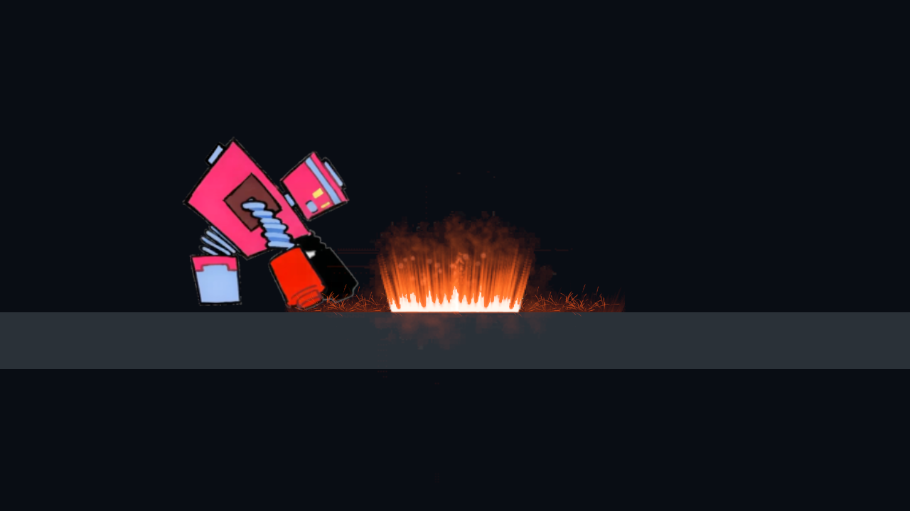
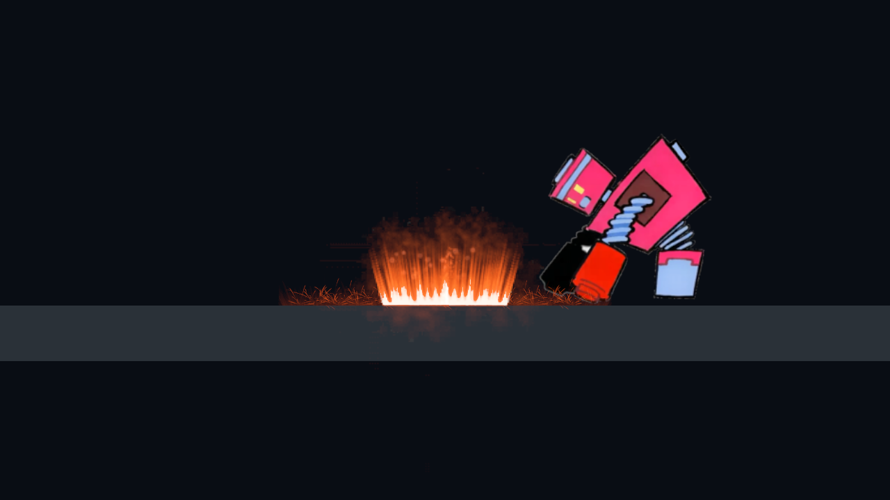
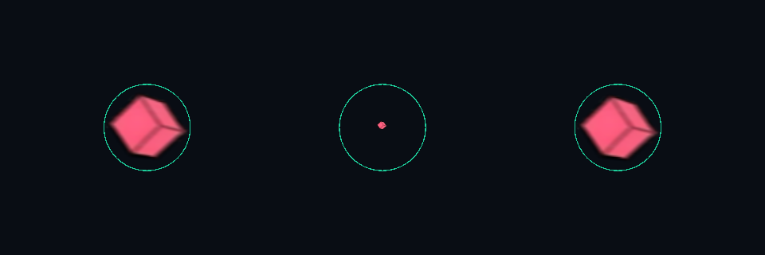
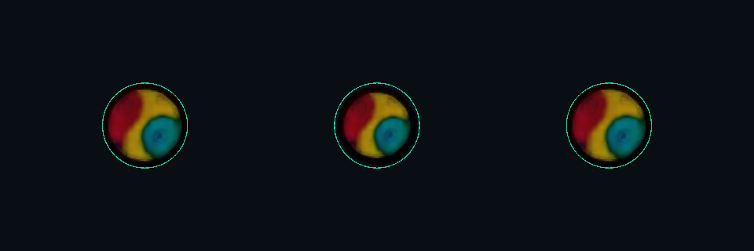
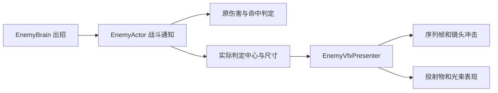

# Boss 特效接入

四个 Boss Prefab 和 `Test_Enemy_*Boss` 白盒已接入特效。打开白盒进入 Play 即可查看；主角默认无敌，F1 推进阶段。兔子已使用当前交付角色及投掷物美术。

下方为三个白盒的实战采样动图，取景放大到交战区域；没有修改正式关卡相机。它用于查看出招效果，不用于衡量帧率。

| Boss | 表现 |
| --- | --- |
| 积木 | 暖色蓄力、砸地冲击、带拖尾的冲击波、分裂能量环 |
| 闹钟 | 表盘发射细线预告，金色外焰和白色激光核心，墙面终点爆发 |
| 兔子 | 粉色能量环、弹体拖尾、出现和消失效果 |
| 蝙蝠 | 紫色三连斩、毛团弹拖尾、阶段碎裂 |

## 2026-10-20：位置与攻击范围校准

原问题在完整工程副本中复现：积木近战可见中心偏高约 0.76 米、砸地偏低约 1.05 米；蝙蝠斩击使用固定正方形，四 Boss 弹芯存在二次缩放/轴心偏差；闹钟交付激光比伤害宽度放大 30%。校准以现有战斗判定为准，未调整 Boss 伤害、攻击范围数值或 AI 选招。

| Boss | 修正 |
| --- | --- |
| 积木 | 普通近身锤击的小圈贴身前地面，保留原素材比例并用五组作者冲击补足宽度；大砸地恢复原序列布局；旋转方块保留交付 PPU 和原有比例，按可见网格中心对齐。 |
| 蝙蝠 | 斩击按实际攻击矩形适配，左右镜像补偿可见中心；冲刺特效跟随每次实际攻击查询，并在攻击结束时清除；毛团弹芯保留原有尺寸与拖尾。 |
| 闹钟 | 三种激光束宽沿用各自 `Width`，束口/末端继续使用表盘轴心和墙面截断点；回退光束核心保持真实宽度，外焰收窄；额外弹幕预警跟随发射原点。 |
| 兔子 | 三类投掷物保留原图 PPU 与逐帧伸缩，以可见图形中心对齐发射轨迹。 |

烘焙图集的透明留白本身也会导致错位。七个 `EnemyVfxClip.VisibleRect` 保存全部有效帧、Alpha ≥ 40/255 像素的联合边界，攻击特效按该边界进行固定轴心适配；动画笔触会随帧变化，弱透明余光不表示额外伤害。替换图集后执行 `RuleGame/Enemies/校准 Boss 特效可见范围（保留战斗参数）`。该菜单只更新片段的边界数据，不重建场景或 Prefab；完整接入菜单也会调用它。

### 普通近身锤击小圈：恢复原素材并修正落点

用户已确认悬空的是 `HammerPlayer` 普通近身锤击的小圈，并非 `HammerGround` 大范围砸地。上一轮误改大砸地并新增的程序方块粒子、三条直线边界已经撤回，`EnemyGroundSlamView` 及其接入已移除。

普通锤击现在沿用原 `Profile.Impact`（Sword3）素材、材质、配色和 `ImpactSize` 比例，将作者特效发射轴心从身体高度移到身前攻击位置的地面；持续攻击的后续帧也使用同一地面投影，不会重新跟到身体中心。按此前“粒子多一点、范围清楚”的要求，使用同套作者的 `Profile.Death`（Blow2）烘焙冲击在攻击宽度内补五组粒子，不增加方块/直线风格。大范围砸地回到添加程序粒子前的原序列布局。投掷物大小和战斗数值保留。

下图是普通近身锤击实际 URP 渲染，各层统一采样在出手后 0.18 秒，未叠加绿色判定框：

完整工程副本 Unity 6000.6.4f1 的最终 17 组检查通过，包括小圈左右朝向的地面轴心、持续跟随、原素材比例、五组作者冲击、无新增方块粒子/边框、暂停、回溯，以及四 Boss 原有对齐/弹体/激光检查。修改前普通锤击左右用例均复现小圈高出地面约 1 米；大范围效果恢复的两个用例也失败，共 13 通过、4 失败，修改后 17 通过、0 失败。日志 `/tmp/rule-brick-normal-author-{before,final}.log`。本轮未重跑完整 Player 构建、正式关卡人工验收或旧战斗回归。

### 投掷物尺寸回归修正

用户反馈统一缩放后投掷物变小，核对后确认上一版 `FitBody` 把 `Sprite.bounds`（含透明画布）当作图形边界。积木方块的画布宽 8.05 世界单位，可见 Tight 网格宽约 1.06；按画布归一化使实际方块缩到原先约 1/8。兔子两帧之间的正常美术伸缩也被强制压到同一直径。此前以 `SpriteRenderer.bounds` 验证尺寸的断言因此漏检了真正的可见图形。

现已撤回投掷物的统一尺寸归一化，恢复交付素材 PPU、动画逐帧比例和原有普通弹/地面波的缩放；仅用缓存的 Sprite 网格联合边界补偿可见中心。碰撞半径、速度和伤害均未调整。新断言核对可见网格中心与调整前的素材比例，原地面波扁平外观断言也已恢复。

下图左为原版、中为错误归一化版、右为本次恢复版，绿圈的碰撞半径始终相同：

验证使用 Unity 6000.6.4f1 完整工程副本 `/tmp/rule-boss-vfx-alignment-20261020`：

- 修改前的 10 组对齐检查全部失败；最终 17 组全部通过，包括普通小圈贴地、左右朝向、冲刺跟随/结束、父物体缩放、单体暂停、回溯清理、四 Boss 所有弹体动画帧的可见中心及原尺寸、三种交付激光和回退激光。
- 原弹体持续可见、暂停、快照、Boss/无特效杂兵池复用回归 11 项通过。
- 原战斗回归为 115 项通过、3 项失败；撤回本次改动后相同 3 项仍失败：兔子近身藏身撤退、小怪普通受击、闹钟休息后重新攻击。未修改这些既有用例或扩大 AI 修复范围。
- 实际 URP 渲染已采样并检查；未运行完整 Player 构建或正式关卡人工验收。几何检查和采样由 `BossVfxAlignmentValidation.RunCalibratedBatch` 生成，只允许在可丢弃的 batchmode 工程副本运行。

[修改前结果](特效预览/BossVfxAlignment/Before.txt) · [修改后结果](特效预览/BossVfxAlignment/After.txt) · [弹体回归](特效预览/BossVfxAlignment/ProjectileRegression.txt) · [战斗回归对照](特效预览/BossVfxAlignment/CombatRegression.txt)

## 如何调整

`Assets/_Project/Data/Enemies/Vfx/*Boss_Vfx.asset` 分别配置各 Boss 的片段、材质、尺寸和镜头冲击。`EnemyVfxClip` 配置图集、8×8 网格、起始帧、结束帧总数和 30 FPS。无需安装 Effekseer 即可运行。攻击范围适配来自战斗通知；普通锤击保留 `ImpactSize` 的原素材比例，并在实际攻击宽度内补同套冲击。`CastSize` 仍控制施法等装饰效果。

给新的 Boss 添加 `EnemyVfxPresenter`，指定 Profile；需要震屏的主相机添加 `BossCameraImpulse`。闹钟的 `EnemyActor.BeamOrigin` 指向表盘轴心，光束显示和伤害判定使用同一原点。

重新生成敌人白盒后，执行菜单 `RuleGame/Enemies/接入 Boss 作者特效（保留 AI 与参数）` 恢复接线。该工具只修改四个 Boss Prefab、特效配置和四个独立白盒。

## 与战斗逻辑的边界

特效订阅动作、攻击、成功规则释放和命中事件。持续攻击窗只通知一次，蝙蝠连斩每刀通知一次。特效不决定伤害、速度、冷却、阶段和规则持续时间。投射物外观使用独立子节点，根节点与碰撞半径沿用原实现。飞行弹芯持续使用 `ProjectileSprite`，`Shot` 仅用于发射瞬间的闪光；其末尾为透明淡出帧，不能循环替换弹芯，否则会周期性消失。

序列帧随世界时间缩放，Boss 实体暂停时停止播放；已发射弹体独立飞行。Boss 快照恢复后清掉旧时间线瞬时效果与拖尾。每个 Boss 最多 12 个复用播放槽，投射物与光束沿用现有对象池。公共弹池被无特效杂兵复用时恢复其原始外观。尚无距离裁剪；大量 Boss 同屏时需另行评估透明绘制成本。

## 资源来源

采用作者 **tktk** 的 [Effekseer Effects vol.2](https://effekseer.github.io/en/contributes/tktk02/index.html) 作品。当前贡献库明确标注 [CC0](https://effekseer.github.io/en/contribute.html)。保留七个 `.efkproj` 及所需纹理于 `Doc/特效资源/tktk02`，便于美术继续编辑。

运行资源是从作者原工程离屏烘焙的序列帧，做了统一中心裁剪、尺寸压缩、透明度转换、末尾渐隐和材质配色。Effekseer 1.80.7 仅作离线烘焙工具，未加入最终游戏依赖。来源及许可见该目录 README；重新烘焙见 `Tools/BossVfx/README.md`。
