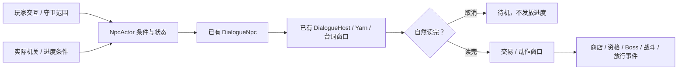

# NPC 配置接入

## 配置与测试

Unity 工程为 `Project-Rule/`，以下路径均从 `Assets/_Project/` 开始。

- **调参数**：`Data/Npcs/*_Definition.asset`，选中后在 Inspector 调整交互距离、冷却、居民移动、精灵和商品列表。
- **接条件/事件**：场景中 NPC 根物体的 `NpcActor` 组件。
- **改台词**：`Data/Npcs/ConfiguredNpcs.yarn`，保留节点名和 `#line` ID。
- **预制体**：`Prefabs/Npcs/`，包含九个 NPC 和共享窗口 `NpcDialogueSystem.prefab`。
- **测试场景**：`Scenes/Test_NpcConfiguration.unity`，打开后按 Play。

`A/D` 移动，空格跳跃，靠近后 `E` 交谈/继续，`Esc` 结束。**右上角复选框可以直接打勾或取消，切换任务条件；退出 Play 不保存。** 齿轮人需先读完首次任务说明，再测试条件分支。商品面板仅展示，不结算购买。

本次来源为 `Src/角色动作需求表（增加NPC需求和行为数据）.xlsb.xlsx` 的「NPC需求表」「NPC行为逻辑」，以及 `Src/NPC（18，5pm完成/`。逐格来源和文件哈希保存在 `Doc/References/Npcs/NpcRequirements.json`。原表与原图不修改。

## 交付资产

Unity 资源均位于 `Assets/_Project/`：

| 路径 | 内容 |
| --- | --- |
| `Art/Sprites/Npcs/` | 十二张裁掉透明边的运行时姿态图、来源哈希和尺寸清单 |
| `Data/Npcs/` | 九份 `NpcDefinition`，十八个状态台词入口及独立兜底、独立 Yarn Project / Content |
| `Prefabs/Npcs/` | 九个角色预制体，共享窗口 `NpcDialogueSystem.prefab` |
| `Scenes/Test_NpcConfiguration.unity` | 独立角色试播场景，不加入 Build Settings |
| `Scripts/Gameplay/Npcs/` | 角色配置、条件分支、交互编排和居民移动 |
| `Scripts/Editor/Npcs/` | 生成、Inspector 试播、配置校验和副本验证 |

角色为商人、镇长、居民 A/B/C、齿轮人、守卫、神秘商人；额外交付的第四款镇民也配置为居民 D，可自行选择摆放。毛绒王国没有新增 NPC。素材只提供静态姿态，两个姿态按待机/交谈切换；未伪造行走、嘴型、鞠躬、砸法杖、拧发条、前戳和放行动画。每份 Definition 的 `MissingAnimations` 明确标注缺项。身高是接入默认值，可按场景缩放。

## 试播与摆放

1. 打开 `Test_NpcConfiguration.unity`，按 Play。场景已接入现有主角预制体和跟随镜头，`A / D` 移动、空格跳跃。
2. 走近 NPC，画面出现「E 与某人交谈」。按 `E` 开始交谈，**或直接攻击命中 NPC**（与按钮、宝箱同一条撞击入口）；再按 `E` 显示整句/继续，`Esc` 结束。手柄对应 `Y / B`。
3. 右上角直接勾选「能力达标」「按钮通电」「齿轮解卡」「持有通行证」「小镇商品买齐」切换真实条件组件；无需操作 Hierarchy 或 Inspector。
4. 商人说完后，Game 画面显示四件商品；按 `E / Esc` 或点击「关闭展示，继续交谈」进入道别。这个面板用于交互验证，不结算购买。
5. 走进守卫范围会自动交谈。交谈与商品展示期间占用现有玩家输入门禁，结束或取消后恢复跑跳和攻击。

⚠️ **NPC 必须放在分区关卡场景**（`Level_Center` / `Level_Start_01` 等），**不能放在 `Boot`**：Boot 不是世界分区，没有地面，主菜单还会把物理停住，NPC 会停在半空、攻击也打不到。

正式场景放一个 `NpcDialogueSystem.prefab`，再拖入所需 NPC。**NPC 的 `_host` 可以留空**：`NpcActor` 会退回 `DialogueHost.Active`（当前启用的共享 Host），也可以在运行时 `npc.BindHost(host)`。NPC Prefab 不嵌入独立 Runner，避免每个人抢一个窗口。

对话的**正式触发走攻击**：`NpcActor` 实现 `IContactSwitch`，攻击盒 / 投射物命中后由 `ImpactByContact` 开播，与按钮、宝箱同一条路（`PlayerController.PressSwitches`），不进伤害管线。命中本身就是触发条件，不再用交互半径二次拒绝；冷却、暂停和 `Sell/PassKey/Attack` 状态闸门仍然生效。

`NpcPlayerInteraction` 仍然负责**阅读期间的输入接管**：挂在现有 `PlayerController` 上，绑定共享 Host，将 `Advance Dialogue` 事件连接到既有 `DialogueToolkitPresenter.Advance`。它负责 E/Y 继续、Esc/B 取消，以及已有输入令牌的取得和释放，尊重其他界面的输入占用。E 键近距离开播保留为兼容入口；正式关卡可以只靠攻击触发，不依赖它。

已有自定义交互入口时，也可调用 **`NpcActor.TryInteract(player.transform)`**。这个包装会选取当前状态入口，再复用已有 `DialogueNpc` 的半径、冷却与 Host 忙碌检查。不要直接调用其内部 `DialogueNpc.TryInteract`，那会绕过角色条件选择。守卫将 `_proximityActor` 接到玩家，以距离轮询实现进入范围自动交谈；离开后可再次触发。

⚠️ 飞刀目前只对 **Trigger** 调 `IContactSwitch`；NPC 身体是实心 CapsuleCollider2D，所以**近战攻击盒可以触发对话，飞刀要额外加一个 Trigger 子物体**才会触发。

已有的 `Data/Dialogue/NpcBarks.yarn`、原三位试播 NPC 和 `DialogueLab` 不替换。新台词在 `Data/Npcs/ConfiguredNpcs.yarn`，直接修改正文即可。表中概念例句用于首轮配置，居民四句是试播文案，尚未视为正式剧情定稿。

## 条件与事件

条件引用必须由实际负责系统更新 `DialogueSceneFlag.SetValue(bool)`。空引用视为未满足，不根据当前规则、血量或场景名称猜测任务进度。

**例外：镇长资格直接读玩家进度**。`NpcActor.HasQualification()` 检查 `PlayerProgress.HasAllUnlocks` —— 六个规则属性、五个规则关系、四项能力（爬墙跳 / 二段跳 / 攻击 / 飞刀）全部解锁才算达标；`_abilityReady` 只保留为白盒/测试的手动覆盖，正式场景留空。

| NPC | 条件及状态 | 完成后的接线 |
| --- | --- | --- |
| 商人 | `Talk → Sell → Bye → Idle` | `_onTradeRequested` 打开商店，关闭时调用 `CloseTrade()` |
| 镇长 | **直接读 `PlayerProgress`**：规则与能力全解锁 → `Talk2`，否则 `Talk1`；`_abilityReady` 仅作白盒覆盖 | 达标对话读完后 `PassKey`，发 `_onQualificationGranted` |
| 居民 | 小范围 `Idle/Walk`，交互为 `Talk` | Rigidbody2D 真实碰撞、重力和质量；墙/悬崖前停步转向 |
| 齿轮人 | 首次 `Talk1`；随后未完成/仅按钮/仅齿轮/全完成为 `Talk2/3/4/5` | 全完成读完后 `PassKey`，发 `_onBossRequested` |
| 守卫 | `_hasPass` 决定 `Talk1/Talk2` | 无证读完发 `_onAttackRequested`；有证读完后关闭可选 `_passageBlocker` 并发 `_onPassageGranted` |
| 神秘商人 | `_townSoldOut` 决定拒绝或 `Talk2 → Sell` | 开店/关闭/道别同普通商人 |

资格、Boss 与放行事件每个实例只发一次，领取记录不随物理回溯重复触发；跨场景、重开和落盘的幂等仍由进度系统负责。外部条件会在动作完成前重新检查。动作计时 `ActionDuration` 当前用来预留完整动画播放窗口；没有实际动画时保持静态姿态。

`_onAttackRequested` 是守卫交给现有战斗系统的请求，**未配置伤害数值、攻击范围或战斗 AI**。商店同样只交付四件普通商品和四件神秘商品的名称/效果配置，未实现支付或升级结算。原表没给价格、血蓝增加量，`Price=-1` 明确表示未配置，不能据此扣款。镇长资格判据已按 2026-10-20 决定改为「规则 6 属性 × 5 关系 + 四项能力全解锁」，不再由场景 flag 手动推进；后续商店与经济仍由负责系统接入，不在 NPC 模块重复实现。

## 暂停、快照与取消

NPC 使用现有 `RuleAffectedBody` 参与规则与内存快照，居民用 `FixedUpdate` 加力移动；其余角色只锁 X 和旋转，重力仍有效。行为计时在 `TimeManager.IsPaused` 时冻结。行为快照保存待机/行走、计时、出生 X、方向和首次交谈记录；对话和商店不回播，恢复为 Idle，外部 UI/交易生命周期由对应系统接管。

`DialogueHost.ConversationFinished(bool)` 新增读完结果；关闭、禁用、异常停止返回 false。`DialogueToolkitPresenter.Close()` 经过 Host 停止，避免把取消当成完成。外部停止也应调用 `Host.StopDialogue()`，不要绕过它直接 `runner.Stop()`。原 `PlayingChanged` 开始/结束通知保留，暂停与输入接管仍沿用原接法。

## 重建和验证

- 刷新图像：使用项目附带 Python/Pillow 执行 `Tools/NpcAssets/import_npcs.py`。使用同一角色姿态并集裁切、统一脚底锚点；已有台词不覆盖。
- Unity 菜单：`Tools → 规则游戏 → NPC → 生成配置、预制体与试播场景`。只生成缺失的角色资产与场景，不覆盖已有调参或关卡。
- Unity 菜单：`Tools → 规则游戏 → NPC → 校验全部 NPC 配置`。检查九个角色、十八个入口、兜底与资源接线。
- 已有旧版试播场景用 `Tools → 规则游戏 → NPC → 接入玩家与场景内交互` 补接主角、镜头、地面和 Game 内控件；不重建 NPC 或覆盖其条件参数。
- `RuleGame.Editor.Npcs.NpcValidation.RunBatch` **仅在临时工程副本**执行，会切换场景、进入 Play 并退出该副本。使用真实 Yarn 和 UI 推进，验证各分支、距离、取消、一次性事件、交易道别、居民暂停及行为快照。

测试场景已接玩家输入；正式地图可复用同一个 `NpcPlayerInteraction`。正式商品购买、资格进度、Boss 生成和守卫战斗仍由各自系统接管；本次未自动修改正式关卡或 Build Settings。

2026-10-18 验证：Unity `6000.6.4f1` 临时完整副本 `/tmp/rule-npc-config-20261018` 中，`RunBatch` 的 **145 项断言全部通过**，进程退出码 0。包含十八个入口的实际播放、距离拒绝、正常/取消收尾、商店关闭后道别、任务分支与一次性事件，以及居民实际物理移动、暂停、行为快照。首轮发现驱动力不足以克服摩擦，调整为独立 `WalkForce=60` 后通过；没有绕过物理强行写速度。最终日志 `/tmp/rule-npc-validation-final.log`，断言记录在 `Doc/References/Npcs/Validation_20261018.txt`。后续单独通过 Play 模式渲染九个真实预制体，预览在 `Doc/Preview/NpcConfiguration.png`；最后一次预览生成也通过完整工程编译。未执行 Player 构建或正式关卡流程验收。

后续补接可操控主角，新增 `NpcPlayerValidation.RunBatch`，通过 Input System 队列发送真实 D/E/Esc/Space 键状态，**22 项断言通过**，退出码 0。覆盖玩家实际走近、最近角色提示、按键开播和继续、输入门禁、商品展示与道别、恢复移动、画面切换任务条件、取消、暂停/其他界面输入占用、守卫范围触发和禁用释放。也修复了快速关闭商店时，道别被重复交互冷却挡住的问题；道别作为同一轮交谈的后续，仍遵守共享 Host 忙碌和内容校验。日志 `/tmp/rule-npc-player-validation-final.log`，记录 `Doc/References/Npcs/PlayerInteractionValidation_20261018.txt`，实际画面 `Doc/Preview/NpcPlayerInteraction.png`。前述 145 项是基础 NPC 配置交付时的结果；本轮只针对新增玩家流程执行这 22 项，没有重复跑全量套件。
