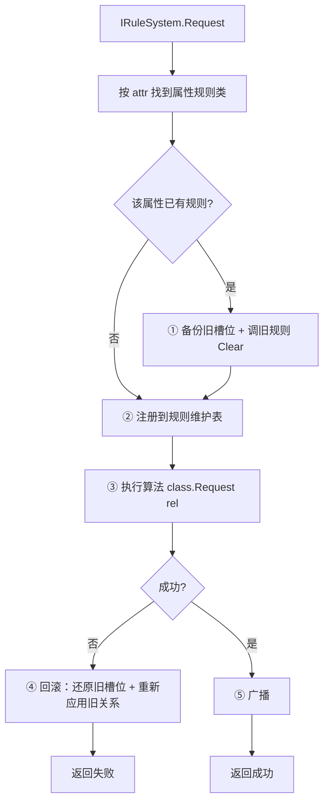
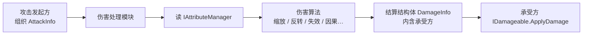
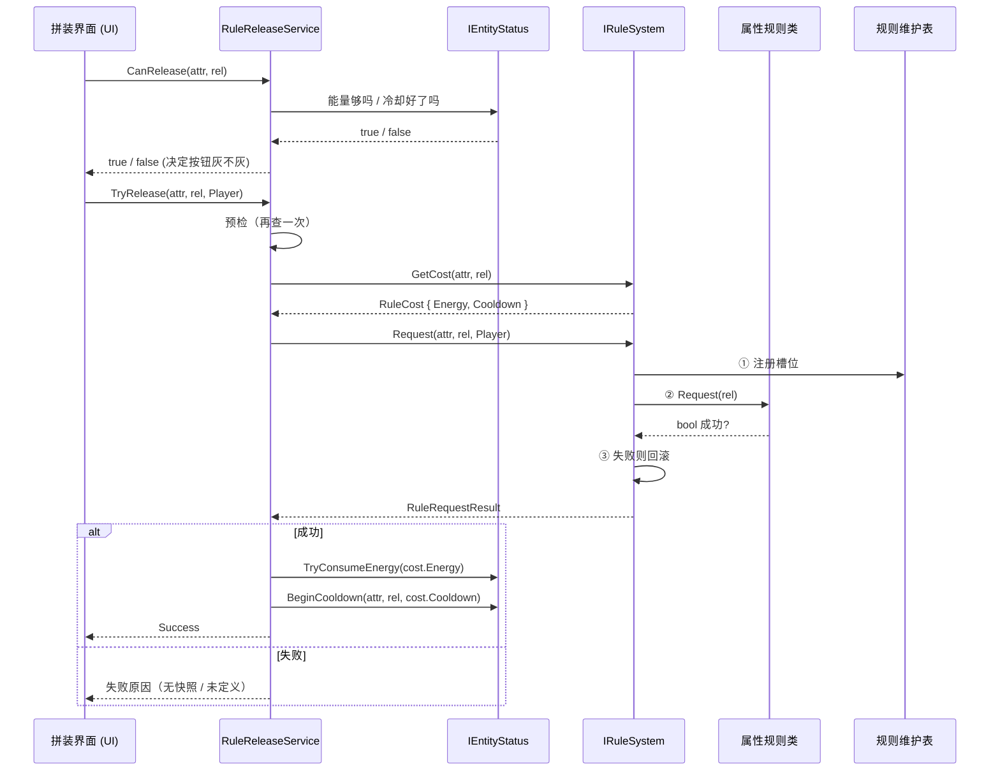
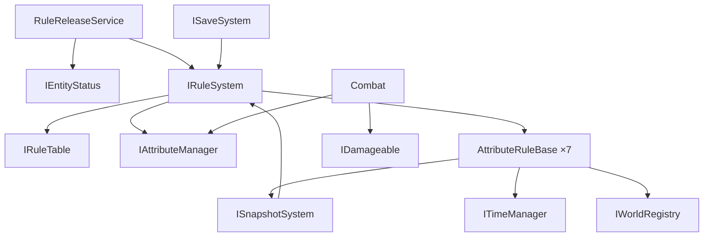

# 《规则游戏》接口与事件定义

> **依据**：[系统模块架构.md](系统模块架构.md) · 修订方案见 [本地文档/接口修订方案.md](../本地文档/接口修订方案.md)
> **版本**：v3.0 · 2026-10-07
> **用途**：**接口冻结文档**。定死后各模块可并行开发。

---

## 一、通用约定

### 1.1 枚举

> 📁 **位置：`Infrastructure/Shared/Rules/`**（不是 `Core/`）
> 原因见 1.4 与 3.2：快照系统需要读规则表，词汇必须在快照系统能看到的地方。

```csharp
public enum AttributeId {
    Gravity,    // 重力
    Time,       // 时间
    Friction,   // 摩擦
    Mass,       // 质量
    Damage,     // 伤害/生命
    Causality,  // 因果
}

public enum RelationId {
    Revert,     // 反转
    Nullify,    // 失效
    Constant,   // 恒定
    Enhance,    // 增强
    Weaken,     // 削弱
}

public enum RuleSource { Player, Enemy, LevelScript }

public enum TimeSource { Rule, UI }
```

> ⚠️ **`RuleSource` 绝不参与优先级判断** —— 单一规则表是「后写覆盖先写」。

### 1.2 事件的使用方式

**使用 C# 原生 `event`，挂在各系统接口上。不设全局事件总线。**

| 做法 | 说明 |
|---|---|
| 事件定义在**拥有该概念的系统接口**上 | 如 `IRuleSystem.OnRuleActivated`、`ITimeManager.OnPausedChanged` |
| 订阅者通过系统引用订阅 | 系统是单例 / 管理器，可取到引用 |
| 跨系统协作走对方的公开方法 | 如场景调用 `ILevelFlow.NotifyGoalReached()` |

**为什么不用全局事件总线**：

- C# 原生 `event` 已经够用，全局总线是多余的一层间接
- 全局静态总线隐藏依赖关系，且难以单独测试
- 事件挂在接口上，**编译器能检查类型**，订阅关系一目了然

### 1.3 规则定义（数据）

`RuleDef` 是**规则系统内部的数据**，**不出现在对外接口签名里**（外部一律用枚举）。

```csharp
[CreateAssetMenu(menuName = "规则游戏/RuleDef")]
public class RuleDef : ScriptableObject {
    public AttributeId Attribute;
    public RelationId  Relation;
    public float Duration;          // <= 0 表示关卡内永久
    public float ActivationCost;    // 唯一的费用字段
    public float Cooldown;          // 冷却秒数，0 = 无冷却
    public string DisplayName;
    [TextArea] public string Description;
}
```

> **只有 `ActivationCost`，没有 `PerUseCost`。**
> 因为反转的「激活」就是「回退」本身，不存在独立的每次使用费。

### 1.4 目录与程序集归属（新增）

**接口层与实现层分离**：

| 内容 | 位置 | 程序集 |
|---|---|---|
| 枚举（1.1） | `Infrastructure/Shared/Rules/` | `RuleGame.Infrastructure` |
| `ActiveRule` / `IRuleTable` | 同上 | 同上 |
| `AttributeValues` / `IAttributeManager` | 同上 | 同上 |
| `IRuleSystem`（接口） | 同上 | 同上 |
| `EntityStatusData` | `Infrastructure/Shared/` | 同上 |
| `RuleTable` / `AttributeManager` / `RuleSystem` | `Core/Rules/` | `RuleGame.Core` |
| `AttributeRuleBase` + 6 个属性规则类 | `Core/Rules/AttributeRules/` | 同上 |
| `RuleDef` / `IRuleCatalog` | `Core/Rules/Data/` | 同上 |

**依赖方向**：

```
Infrastructure/Shared/Rules/   ← 接口 + 词汇（零依赖）
        ↑
Core/Rules/                    ← 实现
```

> **代价（明确接受）**：`Infrastructure` 里出现了带规则语义的接口。这不是纯净的分层，
> 但快照系统需要直接读写规则表，为此写一套事件 + payload 机制不值得。

---

## 二、规则系统

### 2.1 规则维护表

**7 个固定槽位，每属性一个。** 同时是**规则剩余时间的唯一持有者**。

```csharp
public struct ActiveRule {
    public RelationId Relation;
    public float      Remaining;   // 剩余时间；<0 表示永久
    public RuleSource Source;      // 仅用于表现层
}

public interface IRuleTable {
    bool        IsActive(AttributeId attr);
    bool        IsActive(AttributeId attr, RelationId rel);
    ActiveRule? GetSlot(AttributeId attr);
    IReadOnlyDictionary<AttributeId, ActiveRule> Slots { get; }

    // ---- 供快照系统直接读写 ----
    ActiveRule?[] SnapshotSlots();
    void          RestoreSlots(ActiveRule?[] slots);
}
```

> **剩余时间放在表里，不放在属性规则类里** —— 避免同一份状态两处维护。
> 规则系统统一 Tick 所有槽位，到期后调用对应属性类的 `Clear()`。

### 2.2 属性管理器

**外部事实来源。** 只保存「没有引擎全局载体」的属性值。

```csharp
public struct AttributeValues {
    public float FrictionScale;    // 1.0 = 正常
    public bool  FrictionInverted; // 摩擦力方向反向（不是负倍率，见下）
    public float MassScale;
    public bool  MassInverted;     // 重的变轻、轻的变重（逐实体，不能用倍率表达）
    public float DamageScale;
    public bool  DamageInverted;   // 攻防反转
    public bool  DamageDisabled;   // 伤害失效
    public bool  DamageDeferred;   // 伤害挂账（只置位，账本不在规则系统）
}

public interface IAttributeManager {
    AttributeValues Values { get; }

    void SetFrictionScale(float v);
    void SetFrictionInverted(bool v);
    void SetMassScale(float v);
    void SetMassInverted(bool v);
    void SetDamageScale(float v);
    void SetDamageInverted(bool v);
    void SetDamageDisabled(bool v);
    void SetDamageDeferred(bool v);

    void ResetToDefault();

    // ---- 供快照系统直接读写 ----
    void RestoreValues(AttributeValues values);
}
```

> **重力与时间速率不在这里** —— 它们直接写 `Physics2D.gravity` 和 `Time.timeScale`。

> ⚠️ **伤害挂账的边界**：`DamageDeferred` 只是「现在挂账中」这一个事实，
> 规则系统置位它并广播，**到此为止**。账本、净额结算、结算时机属于
> **伤害处理模块或承受方自身** —— 账本是逐实体的，放不进属性规则类。
> 结算时机可参考 `OnRuleExpired`（见 §2.5 的触发契约）。

> ⚠️ **为什么摩擦反转用标志位而不是负倍率**：Unity 会把 `PhysicsMaterial2D.friction`
> 的负值夹到 0，用负数表达反转会直接退化成「失效」。所以反转只置位
> `FrictionInverted`，`FrictionScale` 保持 1.0。
>
> **响应方是谁不在规则系统的职责内** —— 规则类只负责把值摆对并广播
> `IRuleSystem.OnRulesChanged`，实体怎么用这个值由各模块自己决定。

> ⚠️ **为什么质量反转要用标志位**：规则矩阵里「反转 = 重的变轻，轻的变重」是
> **逐实体**语义，而 `MassScale` 是全局倍率，表达不了。所以走 `MassInverted`，
> 由实体按参考质量取倒数（`质量 = 参考质量² / 原始质量`）。
> 与 `DamageInverted` 同一个套路。
>
> **未决**：参考质量目前硬编码为 `1`（见 `RuleAffectedBody.ReferenceMass`）。
> 如果策划希望「正常质量」是别的值，需要改成可配置。

### 2.3 属性规则类基类

**6 个属性各实现一个。基类直接声明五种关系算法。**

```csharp
public abstract class AttributeRuleBase {
    // ---- 依赖注入：没有引擎全局载体的属性靠它写值 ----
    protected IAttributeManager Attributes { get; }
    protected AttributeRuleBase(IAttributeManager attributes);

    // ---- 五种关系算法（子类实现，未定义的返回 false）----
    protected abstract bool OnRevert();
    protected abstract bool OnNullify();
    protected abstract bool OnConstant();
    protected abstract bool OnEnhance();
    protected abstract bool OnWeaken();

    // ---- 统一入口 ----
    public RuleRequestResult Request(RelationId rel) {
        bool ok = rel switch {
            RelationId.Revert   => OnRevert(),
            RelationId.Nullify  => OnNullify(),
            RelationId.Constant => OnConstant(),
            RelationId.Enhance  => OnEnhance(),
            RelationId.Weaken   => OnWeaken(),
            _ => false,
        };
        return ok
            ? RuleRequestResult.Ok()
            : RuleRequestResult.Fail(RuleRequestStatus.NoResource);
    }

    public virtual void Tick(float deltaTime) { }   // 行为型规则覆写
    public virtual void Clear() { }                 // 到期 / 被覆盖 / 重开关卡
}
```

**设计说明**：

| 点 | 说明 |
|---|---|
| **不设 `AttributeId` 属性** | 类名本身就是属性的标识 |
| **不接收 `RuleDef`** | 只接收关系枚举；规则参数由 `IRuleCatalog` 提供 |
| **五算法返回 `bool`** | 只有属性类知道自己是否成功（如「没有可用快照」） |
| **算法跑不通时返回 `false`** | 对应 `RuleRequestStatus.NoResource`。注意「格位在矩阵里不存在」是另一回事——由 `IRuleCatalog.Get` 返回 null 决定，`RuleSystem` 在那一步就返回 `Undefined`，走不到规则类 |
| **计时不在基类** | 剩余时间由规则维护表持有 |
| **基类持有 `IAttributeManager`** | 由 `RuleSystem` 构造时注入（与它自己用的是同一实例）。重力 / 时间拿到也不用 |
### 2.4 规则系统门面

```csharp
public interface IRuleSystem {
    IRuleTable        Table      { get; }
    IAttributeManager Attributes { get; }

    // ---- 写入入口（外部一律用枚举，不传 RuleDef）----
    RuleRequestResult Request(AttributeId attr, RelationId rel, RuleSource source);

    // 主动结束某个属性当前生效的规则（玩家的能力）。
    // 不消耗能量、不影响冷却 —— 取消免费。没有生效中的规则时返回 false 且不广播。
    // 走的是与「超时 / 被覆盖」同一条收尾路径：Clear() → 清槽位 → 广播。
    bool Cancel(AttributeId attr);

    // ---- 费用查询 ----
    RuleCost GetCost(AttributeId attr, RelationId rel);

    // ---- 重开关卡 ----
    void ClearAll();

    // ---- 快照恢复后重建规则效果 ----
    // 按当前规则表静默重施：不触发规则生命周期事件，也不广播 OnRulesChanged。
    // 由 ISnapshotSystem.Restore 在广播 OnRestored 之前调用（恢复本身不发规则事件）。
    void ReapplyActiveEffects();

    // ---- 存档 ----
    List<string> ExportActiveIds();

    // ---- 事件 ----
    // 状态已写完才会触发（先写状态，再广播）
    event Action<AttributeId, RelationId, RuleSource> OnRuleActivated;

    // 不变量：与「某个属性的活跃规则被清掉」一一对应。
    // 触发路径：超时 / 被同属性覆盖 / ClearAll / 主动取消（Cancel）。
    // ⚠️ 例外：快照恢复（IRuleTable.RestoreSlots）不触发，靠 ISnapshotSystem.OnRestored
    event Action<AttributeId>                         OnRuleExpired;

    // 规则表发生任何变化时触发（供 UI 整体刷新）
    event Action                                      OnRulesChanged;
}
```

> ⚠️ **`IRuleSystem` 不认识能量、不认识冷却**（约束 C4）。
> 能量与冷却的检查、扣除在**规则判定中枢**完成（见 4.3）。

### 2.5 规则生效流程

**顺序是：覆盖清理 → 注册 → 执行 → 失败回滚 → 广播。**



**为什么覆盖前要先 `Clear()` 旧规则**（2026-10-12 补）：

纯写值的规则看不出差别 —— 重力 / 摩擦 / 质量 / 伤害的每次 `Request` 都会写全自己那几个字段。
但**带外部状态的行为型规则**漏了这步就会泄漏：伤害挂账的账本没人结算、时间恒定的快照不还原。

`AttributeRuleBase.Clear()` 的注释早就写着「到期 / **被覆盖** / 重开关卡时调用」，
但之前只有「到期」和 `ClearAll` 两条路径真的调了它，覆盖这条是漏的。

**为什么注册在执行之前**：

| 理由 | 说明 |
|---|---|
| 执行期间读表一致 | 算法内部若查询规则表，读到的已经是新状态 |
| 快照恢复可重入 | 时间规则的执行会触发快照操作，此时表已一致 |

**为什么广播在最后**：订阅者（HUD、存档）收到事件后会去查规则表。
如果事件先发、状态没写完，订阅者会读到旧值——这是最难查的一类 bug。

**规则**：**先写状态，再广播。** 永远不要反过来。

**失败回滚**（2026-10-12 改）：

```csharp
public RuleRequestResult Request(AttributeId attr, RelationId rel, RuleSource source) {
    var cls = _rules[attr];
    var def = _catalog.Get(attr, rel);

    // ① 备份旧槽位
    ActiveRule? previous = _table.GetSlot(attr);
    ActiveRule?[] backup = previous.HasValue ? _table.SnapshotSlots() : null;

    // ② 覆盖前先恢复旧世界
    if (previous.HasValue) cls.Clear();

    // ③ 注册（先写状态）
    _table.Set(attr, rel, def.Duration, source);

    // ④ 执行
    var result = cls.Request(rel);

    // ⑤ 失败回滚：还原槽位**和**规则类状态
    if (!result.Succeeded) {
        if (previous.HasValue) {
            _table.RestoreSlots(backup);
            cls.Request(previous.Value.Relation);   // 重新应用旧关系
        } else {
            _table.Clear(attr);
            cls.Clear();
        }
        return result;
    }

    // ⑥ 广播
    if (previous.HasValue) OnRuleExpired?.Invoke(attr);
    OnRuleActivated?.Invoke(attr, rel, source);
    OnRulesChanged?.Invoke();
    return result;
}
```

> **旧版是「失败时 `_table.Clear(attr)`」** —— 那等于「请求失败反而把原来生效的规则也弄丢了」。
> 现在还原到请求之前的状态。

#### `OnRuleExpired` 的触发契约

**不变量**：`OnRuleExpired(attr)` 与「某个属性的活跃规则被清掉」一一对应。

| 规则结束方式 | `Clear()` | `OnRuleExpired` | `OnRulesChanged` |
|---|---|---|---|
| 超时 | ✓ | ✓ | ✓ |
| 被同属性覆盖 | ✓ | ✓ | ✓ |
| `ClearAll` | ✓ | ✓（每个原本活跃的属性各一次） | ✓ |
| 主动取消（`Cancel`） | ✓ | ✓ | ✓ |
| 快照恢复（`RestoreSlots`） | ✗ | ✗ | ✗ |

> ⚠️ **快照恢复是唯一的例外**：它直接覆盖槽位，不经过 `Request`。
> 需要在恢复后收尾的模块订阅 `ISnapshotSystem.OnRestored`。

### 2.6 费用与结果（新增）

```csharp
public readonly struct RuleCost {
    public float Energy;      // 能量消耗
    public float Cooldown;    // 冷却秒数，0 = 无冷却
}

public enum RuleRequestStatus {
    Success,
    Undefined,     // 该 属性×关系 未定义（规则矩阵里的空格）
    NoResource,    // 行为型规则缺资源，如「没有可用快照」
}

public readonly struct RuleRequestResult {
    public readonly RuleRequestStatus Status;
    public bool Succeeded => Status == RuleRequestStatus.Success;
    public static RuleRequestResult Ok()  => new(RuleRequestStatus.Success);
    public static RuleRequestResult Fail(RuleRequestStatus s) => new(s);
}
```

---

## 三、基础设施

### 3.1 时间管理器

**时间机制开关的唯一持有者。**

```csharp
public interface ITimeManager {
    // ---- 查询 ----
    float TimeScale { get; }               // 合成后的最终倍率
    bool  IsPaused  { get; }
    bool  TimeMechanicsEnabled { get; }    // 供冷却 / Buff / Debuff 读取（唯一来源）

    // 供规则系统等按帧推进的系统使用；暂停时返回 0。
    // 暂停不走 Time.timeScale = 0，所以 Time.deltaTime 在暂停期间照常推进，
    // 必须有一个「暂停时为 0」的出口。
    float DeltaTime { get; }

    // ---- 时间来源（乘法合成，枚举标识）----
    void PushScale(TimeSource source, float scale);
    void RemoveScale(TimeSource source);

    // ---- 暂停 ----
    void SetPaused(bool paused);

    // ---- 事件 ----
    event Action<float> OnTimeScaleChanged;
    event Action<bool>  OnPausedChanged;
    event Action<bool>  OnTimeMechanicsChanged;
}
```

**使用示例**：

| 场景 | 调用 |
|---|---|
| 拼装界面打开 | `SetPaused(true)` |
| 时间削弱规则生效 | `PushScale(TimeSource.Rule, 0.5f)` |
| 时间失效规则生效 | 设置 `TimeMechanicsEnabled = false`，**不改 TimeScale** |
| 规则到期 | `RemoveScale(TimeSource.Rule)` |

> **时间管理器只负责速率与开关。** 恒定 / 反转的行为逻辑在规则系统里。

#### 暂停的实现方式（⚠️ 不能用 `Time.timeScale = 0`）

策划案 §3.1 明确禁止用 `Time.timeScale = 0` 做暂停（它会让 UI、动画、音频一起冻死）。
正确做法是**切换物理模拟模式**：

```csharp
// 暂停
Physics2D.simulationMode = SimulationMode2D.Script;
// 恢复
Physics2D.simulationMode = SimulationMode2D.FixedUpdate;
```

暂停期间物理不再自动步进；需要慢动作时由手动 `Physics2D.Simulate(dt)` 驱动。

> **连带约束**：`Time.timeScale` 保持 1，所以 `Time.deltaTime` 在暂停期间**照常推进**。
> 任何用 `Time.deltaTime` 计时的系统（规则时长、冷却、Buff 剩余时间）
> 必须在暂停时拿到 0，或干脆跳过 Tick。
>
> ✅ **已落地（2026-10-12）**：`RuleSystemDriver.Update` 现在读
> `TimeManager.Instance.DeltaTime`，且 `dt <= 0` 时整帧不 Tick ——
> 暂停期间规则时长与冷却都不再流失。旧的「过渡期 `IsPaused` 布尔量」也已删除。

### 3.2 快照系统

**为「时间恒定」「时间反转」提供统一的世界状态保存/恢复能力。**
（重开关卡**不走快照**：重开 = 场景重载 + 存档重放规则，见 §3.3 与架构 §6.1。2026-10-14 定）

#### 采集范围：快照名册（不是活动实体注册表）

快照遍历 **`ISnapshotRoster`（快照名册）**，**不是** `IWorldRegistry`（活动实体注册表）。
两者成员资格不同：

| 集合 | 成员资格 | 消费者 |
|---|---|---|
| `IWorldRegistry`（活动实体） | `OnEnable` 进 / `OnDisable` 出 | 伤害扩散（`DamageProcessor`）· 规则效果重建 |
| `ISnapshotRoster`（快照名册） | **扫描登记 / `OnDestroy` 出** | `ISnapshotSystem` |

> 🔴 **为什么必须分开**：Unity 对**初始就禁用**的对象不会调 `Awake` / `OnEnable`，
> 靠 `OnEnable` 登记的名册收不到它们；而「采集时就是禁用的门 / 敌人」恰恰是
> 「世界回到那一刻」必须记住的一批。名册由 `SnapshotScope.Rebuild()` 在关卡加载时
> 一次性扫描（`FindObjectsByType(FindObjectsInactive.Include)`），运行时生成的对象自己登记。

#### 快照数据结构

```csharp
public class Snapshot {
    public float CapturedAt;
    public List<EntityState> Entities;
    public ActiveRule?[]     RuleSlots;    // 6 个属性槽位
    public AttributeValues   Attributes;   // 属性管理器值
    public int               Seq;          // 环形缓冲序号（单调递增，不受裁剪影响）
}

public struct EntityState {
    public IRuleAffected    Entity;
    public Vector2          Position;
    public Vector2          Velocity;
    public float            Rotation;
    public bool             ActiveSelf;     // 采集时刻的 activeSelf（含「当时就是禁用」）
    public int              AnimatorStateHash;
    public float            AnimatorNormalizedTime;
    public EntityStatusData Status;
    public bool             HasModuleState; // 显式标志：区分「没有参与者」与「参与者状态为 null」
    public object           ModuleState;
}

public enum RestoreMode { Full, KeepEnergy }  // KeepEnergy：时间系回溯不退能量
```

> **不记录**：粒子、特效。恢复时直接重启，视觉上无感。
> **`ObjectActiveState` 已并入 `EntityState.ActiveSelf`** —— 名册统一后两者本就 1:1（2026-10-14 定）。

#### 接口

```csharp
public interface ISnapshotSystem {
    // ---- 单点快照 ----
    Snapshot Capture();
    void     Restore(Snapshot snap, RestoreMode mode = RestoreMode.Full);

    // ---- 环形缓冲（时间反转）----
    int  CaptureToBuffer();                    // 返回序号（单调递增）
    bool TryPeekSecondLast(out Snapshot snap); // 只读倒数第二张（首选回溯目标）
    bool TryPeekOldest(out Snapshot snap);     // 只读最旧的一张（反转的兜底）
    void DiscardNewerThan(int index);
    void ClearBuffer();

    // ---- 定点（时间恒定）----
    int  Pin();                                        // 采集并固定，返回句柄（>0）
    bool TryRestorePinned(int handle, RestoreMode mode = RestoreMode.Full);
    void Unpin(int handle);

    event Action OnRestored;
}
```

> **拍照节奏归规则类，快照存储归快照系统**（2026-10-14 定）：环形缓冲的间隔与
> 「何时 `Pin` 定点」是规则策略，留在 `TimeRule`；拍下来的 `Snapshot` 由本系统持有，
> 规则类只拿句柄。

> **反转的回溯目标有兜底**（2026-10-16 定）：优先 `TryPeekSecondLast`（保证至少回到 5 秒前）；
> 不足两张时退到 `TryPeekOldest` —— `TimeRule` 在开局第一帧垫的那张。
> 所以开局就有得退，只有缓冲**完全为空**才 `NoResource`。

**规则状态的读写**（快照系统直接持有 `IRuleSystem` 引用）：

```csharp
// 采集
snap.RuleSlots  = _rules.Table.SnapshotSlots();
snap.Attributes = _rules.Attributes.Values;

// 恢复
_rules.Table.RestoreSlots(snap.RuleSlots);
_rules.Attributes.RestoreValues(snap.Attributes);
_rules.ReapplyActiveEffects();   // ← 必须：恢复不触发规则事件，效果要静默重建
```

> **恢复时连 `Remaining` 一起回退。** 快照的语义就是「世界回到那一刻」。时间恒定的专用键回溯保留其自身窗口的当前剩余时间（其它槽位照常回退），使规则矩阵 v2.5 规定的限时窗口不会因反复回溯而无限续期。

> ⚠️ **恢复不触发任何规则事件**（`Clear` / `OnRuleExpired` / `OnRulesChanged` 全是 ✗，见 §2.5）。
> 因此 `Restore` 在广播 `OnRestored` 之前必须调 **`IRuleSystem.ReapplyActiveEffects()`**：
> 按恢复出来的槽位静默重施（重力写 `Physics2D.gravity`、质量 / 摩擦让实体重读 `AttributeValues`）。
> 否则会出现「规则表回去了、世界上的效果没回去」。

> 🔴 **对象一律「禁用」而非销毁** —— 这是 `ActiveState` 能恢复的前提。
### 3.3 关卡流程

```csharp
public interface ILevelFlow {
    int CurrentLevel { get; }
    IReadOnlyList<int> ClearedLevels { get; }

    // ---- 请求（内部走事件，不直接调用场景 / 存档）----
    void RequestRestart();
    void RequestNextLevel();
    void NotifyGoalReached();

    // ---- 状态写入（P1 补充，2026-10-12 并入本文件）----
    void StartLevel(int level);                                        // 场景加载完成后由场景系统调用
    void NotifyLevelFailed();                                          // 由关卡逻辑调用
    void SetProgress(int currentLevel, IEnumerable<int> clearedLevels); // 存档恢复：只写状态，不发事件

    // ---- 事件 ----
    event Action<int> OnLevelStart;
    event Action<int> OnLevelComplete;
    event Action<int> OnLevelFailed;
    event Action<int> OnRestartRequested;
    event Action<int> OnNextLevelRequested;
}
```

> **约束**：不直接调用场景系统、不直接调用存档系统。所有跨系统协作走事件。

### 3.4 对象注册表

```csharp
public interface IRuleAffected {
    Rigidbody2D  Body      { get; }
    Collider2D[] Colliders { get; }
}

public interface IWorldRegistry {
    void Register(IRuleAffected entity);
    void Unregister(IRuleAffected entity);
    IReadOnlyList<IRuleAffected> All { get; }
}
```

| 类型 | 文件位置 | 程序集 |
|---|---|---|
| `IRuleAffected` / `IWorldRegistry`（接口） | `Infrastructure/Shared/Common/` | `RuleGame.Infrastructure` |
| `WorldRegistry`（实现） | `Infrastructure/Common/` | 同上 |
| `RuleAffectedBody`（可复用适配组件） | `Gameplay/Common/` | `RuleGame.Gameplay` |

**用途**：摩擦 / 质量遍历（改碰撞体材质与刚体质量）、快照采集。

> ⚠️ **不要每帧 `FindObjectsOfType`** —— 注册表就是为替代它而存在的。

**约定**：

- **实体自己登记**：`OnEnable` 调 `Register`，`OnDisable` 调 `Unregister`。注册表不做自动发现。
- **重复登记会被静默去重**；`null` 被忽略。
- `All` 返回**只读视图**，不是快照副本。**遍历过程中不要增删**。
- 已销毁但没来得及注销的实体会被自动剔除（兜底），但正常路径仍要求实现者自己注销。
- `Colliders` 每次访问都会分配数组，**规则类应缓存**，不要每帧读。

#### 新登记的实体如何拿到已生效的规则

> ✅ **已决（P2 提出，2026-10-09）：不需要新增任何事件。** 采用下面的**自读模型**：
>
> 1. 规则类只改 `IAttributeManager` 里的**一个缩放系数**（如 `SetFrictionScale(2f)`），
>    **不遍历注册表**。
> 2. 实体在 `OnEnable` 里**登记之后立刻读一次** `Values` 并应用到自己身上。
> 3. 实体同时订阅 `IRuleSystem.OnRulesChanged`，规则一变就重新读值应用。
>
> 于是「规则生效后才生成的实体」在登记那一刻就拿到了最新值，
> 而注册表**只用于快照采集**，不参与规则施加。

#### 摩擦的可实现性（⚠️ 硬约束）

`Collider2D.sharedMaterial` 是**共享**的，直接改它的 `friction` 会污染所有用同一材质的物体。
要缩放单个实体的摩擦，必须给它一份**独占**材质。

而 `PhysicsMaterial2D` **没有公开构造函数**——Unity 官方 XML 文档里整个
`UnityEngine.Physics2DModule` 只有 `PhysicsShapeGroup2D` 一个 `#ctor`，
`unity_builtin_extra` 里也没有内置的 2D 物理材质。
**唯一取得方式是 `Object.Instantiate` 克隆一份已有材质。**

所以项目必须常备一个可克隆的模板材质：

| 资产 | 路径 | Class ID |
|---|---|---|
| 默认摩擦模板 | `Assets/_Project/Data/Resources/RuleDefaultMaterial2D.asset` | 62 |

`RuleAffectedBody` 按以下顺序解析克隆来源：
组件上的 `_frictionSource` → `Rigidbody2D.sharedMaterial` →
第一个非空 `Collider2D.sharedMaterial` → `Resources.Load("RuleDefaultMaterial2D")`。
四个都拿不到时打一次警告并**跳过摩擦**（质量仍然生效）。

> **对 P3 / P4 的要求**：实体想响应摩擦规则，必须至少满足上面四条之一；
> 最省事的做法是给碰撞体挂上项目统一的 2D 物理材质。

### 3.5 世界分区与流式加载（P1 补充，2026-10-16）

**世界是一整张连续大地图，玩家体验是连续的；搭建时按分区切成独立场景，运行时按需加载 / 卸载。**

```csharp
public sealed class PartitionCatalog : ScriptableObject {
    public struct PartitionEntry {
        public int     PartitionId;
        public string  ScenePath;      // 分区场景，几何必须摆在世界坐标上
        public Vector2 Center;         // 世界矩形中心
        public Vector2 Size;
        public float   LoadRadius;     // <= 0 用表上的默认值
        public bool    AlwaysLoaded;   // 起点 / 枢纽常驻
    }
    public void CollectWanted(Vector2 point, List<int> results);
    public static bool WithinRange(in PartitionEntry e, Vector2 p, float margin);
}
```

| 类型 | 文件位置 | 程序集 |
|---|---|---|
| `PartitionCatalog`（分区表 SO） | `Infrastructure/LevelFlow/` | `RuleGame.Infrastructure` |
| `WorldStreamer`（流式加载） | `Gameplay/Scene/` | `RuleGame.Gameplay` |
| `PlayerSpawnPoint`（开局 / 重开出生点） | `Gameplay/Scene/` | 同上 |

**判定**：`WorldStreamer` 每 0.2 秒读玩家位置，把落在「分区矩形 + `LoadRadius`」内的分区收进集合，
与当前在场集合做差 —— 新增的 `LoadSceneAsync(Additive)`，离开
「矩形 + `LoadRadius` + 迟滞」的 `UnloadSceneAsync`。**一次只开一个异步加载**，预载半径负责给缓冲。

**为什么范围记在表里、不放在场景里**：运行时读不到一个**尚未加载**的场景的范围，
而「该预载哪几个分区」必须在加载之前就算出来。

**为什么分区场景的几何必须摆在世界坐标上**：加载后不做任何偏移，直接拼成一张连续地图。
一旦有人把某个分区挪回原点，接缝就会错位。

> ⚠️ **分区边界处的外露面判断**：铺装器（`GroundArtDresser`）判断暴露面是
> 「从这个面往外走 64 格有没有实心格」。分区独立成场景后，边界外侧的邻居地形不在场，
> 会被误判为暴露面并铺上墙皮；世界拼起来后接缝两侧墙皮重叠发亮。
> 铺装时必须读分区表（出界后按邻居矩形继续查，或把边界外视为实心），
> 或把相邻分区一起 additively 打开再铺。

> ⚠️ **`FindAnyObjectByType` 在多分区下不再等于「本场景」**。凡是「场景内找同类」的组件
> （如 `RevealRegion` 找 `SecretWallField`）都要改成只在自己所属分区里找。

> ℹ️ **对象注册表与规则系统天然正确**：实体 `OnEnable` 注册 / `OnDisable` 注销，
> 分区加载卸载自动进出；新实体在 `OnEnable` 里自读一次属性值，自动继承当前生效的规则。
> 规则系统随 `LevelRuntime` 常驻后，「跨关规则延续」这个问题本身就不存在了。

> ℹ️ **快照只覆盖已加载分区**：`SnapshotSystem.Capture` 遍历注册表，卸载的分区不在里面。
> 时间反转窗口只有几秒、玩家不会跨分区，可接受 —— 但不要拿它当存档点。

---

## 四、实体与玩法

### 4.1 实体状态组件

```csharp
public interface IEntityStatus {
    // ---- 能量 ----
    float Energy    { get; }
    float EnergyMax { get; }
    bool  TryConsumeEnergy(float amount);   // 不足则返回 false，不扣除
    void  RestoreEnergy(float amount);

    // ---- 生命 ----
    float Health    { get; }
    float HealthMax { get; }

    // ---- 持有物 ----
    object HeldItem       { get; }
    int    ThrowableCount { get; }

    // ---- 冷却（按 属性×关系 索引）----
    bool  IsOnCooldown(AttributeId attr, RelationId rel);
    void  BeginCooldown(AttributeId attr, RelationId rel, float seconds);
    float GetCooldownRemaining(AttributeId attr, RelationId rel);

    // ---- 事件 ----
    event Action<float, float> OnEnergyChanged;
    event Action<float, float> OnHealthChanged;
    event Action<AttributeId, RelationId, float> OnCooldownStarted;
}
```

**归属**：**玩家**与**敌人**各挂一个。两者行为可不同，接口一致。

> **冷却放在这里**而不是规则系统：它已经是「实体状态」，且敌人也有自己的冷却。

### 4.2 伤害

#### 伤害结构体

```csharp
public struct DamageInfo {
    public object Attacker;   // 施加方
    public object Target;     // 承受方
    public float  Amount;     // 伤害数值
    public float  Knockback;  // 击退数值
}
```

#### 承受方接口

```csharp
public interface IDamageable {
    void ApplyDamage(in DamageInfo damage);
}
```

> **不暴露抗性值** —— 抗性逻辑写在各自的 `ApplyDamage` 实现内部。
> 这样规则系统不需要知道任何实体的抗性（约束 C4）。

#### 攻击流程


| 步骤 | 说明 |
|---|---|
| 1. 构造攻击碰撞体 | 施加方在攻击时生成判定区域 |
| 2. 获得承受方 | 检测与该碰撞体相交的**受击箱**（见下节），而不是身体碰撞体 |
| 3. 构造 `DamageInfo` | **伤害数值由施加方计算**（基础值 × 属性管理器的伤害缩放） |
| 4. 传给承受方 | 调用 `IDamageable.ApplyDamage` |
| 5. 承受方应用 | 内部处理自身抗性、扣血、击退、死亡 |

#### 受击箱（Hurtbox，**已实现 2026-10-17**）

> **「能不能被打到」由受击箱唯一决定**：物理碰撞体只回答「撞不撞得到」，
> 受击箱只回答「打不打得到」。两者是**两块独立的几何** —— 想调打击手感改受击箱，
> 想调移动与阻挡改物理碰撞体，互不牵连。

| 项 | 约定 |
|---|---|
| 组件 | `RuleGame.Gameplay.Combat.Hurtbox`（`Scripts/Gameplay/Combat/`） |
| 摆放 | **独立子物体** + Trigger 碰撞体，图层固定 `Hurtbox`（**层 10**）。碰撞体的图层跟 GameObject 走，所以必须是独立物体 |
| 承受方 | `_owner` 显式指定（实现 `IDamageable` 的组件）；留空则取父链上的第一个 |
| 数量 | 一个实体可以有**多个**（本体 / 弱点）；命中按承受方去重，一刀同时罩住两个箱子只结算一次 |
| 掩码 | 所有查询入口一律用 `Hurtbox.Mask` —— **调用方不再自带 LayerMask**（`PerformAttack` 已删掉 mask 参数） |
| 物理 | 层 10 在 2D 碰撞矩阵里**与所有层都不碰**（受击箱不参与任何物理回调）；显式查询不看矩阵，所以「打得到」不受影响 |
| 尺寸 | 约定为身体碰撞体的 **0.75 倍（线性）**，手感参数，按场景调 |
| 关掉 | `Hurtbox.SetHittable(false)` = 这个部位暂时不可被击中（例：`EnemyWeakPoint` 开合） |

**命中准入（`CombatSystem.CanHit`，全游戏唯一一处）**——受击箱是所有实体共用的一层，
所以「打谁不打谁」必须是显式规则：

1. **自己不打自己**（玩家 1.2 宽的攻击盒会盖到自己的受击箱，不挡就是自伤）；
2. **双方都有阵营时只打敌对阵营**（敌人的判定同样会盖到同伴的受击箱）；
3. 有一方没有阵营（机关 / 场景道具）→ 放行，免得中立物体莫名免疫。

> ⚠️ **抗性 / 无敌帧不进受击箱**（约束 C4）：它们仍然只写在承受方的 `ApplyDamage` 里。
> 受击箱只回答「这块几何算不算被打中」。
>
> ⚠️ 因果反转（伤害落到发起方自己头上）走 `DamageProcessor` 内部的目标替换，**不经过准入**，
> 所以第 1 条不会把它挡掉。

**改造过的判定入口**（原来各配一个 mask，现在统一走受击箱 + `CanHit`）：

| 入口 | 文件 |
|---|---|
| 挥砍（玩家轻重击 / 敌人招式） | `CombatSystem.PerformAttack` |
| 敌人身体接触伤害 | `EnemyActor.TickContactDamage` |
| 敌人弹体 | `EnemyProjectile`（掩码 = `Hurtbox.Mask \| 地形层`；**射手自己的受击箱要穿过去，不能当场消散**） |
| 敌人光束 | `EnemyBeam` |
| 危险瓦片（刺格） | `HazardField`（对谁都扎，不套阵营准入） |

**接线工具**：`Tools/规则游戏/受击箱/① 给当前场景补`、`② 给预制体补`（`Editor/Combat/HurtboxBuilder.cs`）。
已存在的受击箱不重建，只补缺失的；P4 以后加新敌人先跑一遍预制体那条。

#### 伤害处理模块（**提案 · 未冻结 · 2026-10-11 · 已于 2026-10-12 落地**）

> ⚠️ 本节由 P3 提出，**结构尚未冻结**（接口签名还在演进）。P3 接到的新任务是：
> 所有与伤害相关的规则（含未来的「因果」）都由 P3 实现。原链路由 `CombatSystem`
> 一人承担 **命中判定**与**伤害结算**两件事，本提案把两者拆开，为因果等规则留出落点 ——
> **拆分已完成**，见下方「拆分落地」。



| 步骤 | 说明 |
|---|---|
| 1. 组织 `AttackInfo` | 发起方（玩家 / 敌人）填写攻击的基础信息 |
| 2. 交给伤害处理模块 | 模块是**唯一的伤害出口**，发起方不再自己算 |
| 3. 读当前规则 | 读 **`IAttributeManager`**，不是读规则表 —— 理由见下 |
| 4. 算出结算结果 | 伤害相关算法（含因果）都收敛在这里 |
| 5. 改变实体状态 | 交给承受方，模块不碰生命值 |

**依赖（关键，别搞反）**：伤害处理模块读 **`IAttributeManager`**，不读 `IRuleSystem`。
属性管理器就是「规则生效后的事实来源」—— `DamageRule` 已经把结果写进
`DamageScale` / `DamageInverted` / `DamageDisabled`。若由伤害模块去解释
「现在有哪些规则生效」，等于把算法从属性规则类搬回战斗侧，违反 **D10**（算法收归属性规则类）
与「规则系统不做特例判断」。

**位置**：`Scripts/Gameplay/Combat/`，住在规则系统**下游，只读不写入**。
建议按 `RuleReleaseService` 的做法**构造注入** `IAttributeManager`，而不是取 `RuleSystem.Instance`
单例 —— 否则这个核心模块没法单元测试。

**沿用现有冻结结构**：结算输出继续用 §4.2 的 `DamageInfo`，**不要改它的字段** ——
`EntityDamageable`、HUD、VFX 都在订阅。新增的只有发起方填写的 `AttackInfo`。

**边界（两条硬约束）**：

| 约束 | 说明 |
|---|---|
| 抗性 / 无敌帧**不进**本模块 | 约束 C4：免疫写在实体自己的物理属性里，现由 `EntityDamageable` 承担。模块负责**算多少**，承受方负责**扣不扣** |
| 模块不认识「玩家 / 敌人」 | 与规则系统同一口径 |

**未决问题（开工前必须定）**

| # | 问题 | 影响 |
|---|---|---|
| 1 | `AttackInfo` 需要哪些字段？ | 发起方与模块的契约 |
| 2 | 因果 × 反转（受到攻击时攻击者受伤）要求结算**可再入** —— 必须有**深度上限或 `IsReflected` 标记** | 否则两个实体互相反伤会无限递归 |
| 3 | 因果 × 增强要「攻击扩散到周围」→ 需要**范围内的实体查询**；要「治疗扩散到全队」→ 需要**阵营概念**。而阵营原本由**「关系」属性**承载，**该属性已被删除** | 阵营数据放哪（`IEntityStatus`？独立组件？P1 的 `IWorldRegistry`？）需要新落点；范围查询依赖 P1 的 `IWorldRegistry`（未实现） |
| 4 | 因果 × 失效在规则矩阵里仍是 `undecided` | 该格位保持 `Undefined`，不建 RuleDef 资产 |

#### 挂账账本（**已实现 2026-10-12**）

「伤害 / 生命 × 恒定」的账本已落地，位置 **`Gameplay/Combat/DamageLedger.cs`**，
由 `CombatSystem` 持有并驱动。规则系统那边只置位 `AttributeValues.DamageDeferred`（P2 已完成），
账本、净额、结算时机都在伤害模块这边（与 §2.2 的分工一致）。

**账长什么样**：对每个承受方只累加**一个净额** `Net` —— 伤害加、治疗减。
「窗口内的治疗可抵消挂账」因此是免费的：结算时交出去的就是净额。

**结算时机**：订阅 `IRuleSystem.OnRuleExpired`，过滤到 `AttributeId.Damage`。

> ⚠️ **为什么是事件而不是每帧轮询标志位**（实现时踩到过）：
> 标志位在 `RuleSystemDriver.Update`（顺序 −100）里落定，而 `CombatSystem.Update` 是默认顺序 0，
> 与敌人的 `Update` 谁先谁后**不确定**。轮询会漏进这个竞态 ——
> 敌人恰好在同一帧先动手，那一击正常结算、给承受方挂上无敌帧，
> 紧接着的轮询结算就被无敌帧**整笔吞掉**，账凭空消失。
> 订阅事件则在规则结束的那一刻**同步**结算（严格早于所有默认顺序的 `Update`），竞态不存在。

**已定的取舍**（实现时明确，供评审）：

| 点 | 取值 | 理由 |
|---|---|---|
| 挂账期间是否立即扣血 | **否** | 规则的原文就是「不立即扣血，先记账」 |
| 挂账期间是否立即击退 | **否** | 同上一条：整记打击都被推迟，只推迟血会显得半吊子 |
| 挂账期间是否广播 `OnDamageApplied` | **否**，改广播新增的 `OnDamageDeferred` | 此刻确实什么都没发生，广播了 VFX / 音效会在没掉血的实体身上照放 |
| 结算是否走抗性 / 无敌帧 | **走**（结算走的就是 `IDamageable.ApplyDamage` 原路） | 守约束 C4：免疫写在实体自己身上，模块不替它决定 |
| 净额为 0 | 不产生打击，也不广播 | 伤害与治疗正好抵消，没有账要清 |

> ⚠️ **已知的语义缺口（未解决，需要策划确认）**：挂账窗口内，模块在把伤害交给**承受方之前**
> 就拦下了，所以承受方的**无敌帧与抗性在整个窗口内完全不参与**。
> 后果：窗口内连打 10 下会全额累加，结算时才按一次抗性算 —— 对同一个目标，
> 挂账窗口内吃到的总伤害**可以高于**不挂账时（不挂账时无敌帧会挡掉大部分）。
> 若策划认为这过强，可选方案是在 `IDamageable` 上加一个「记账」入口，让承受方**自己**过滤 ——
> 那属于接口变更，需要先冻结。

**新增事件（在实现类 `CombatSystem` 上，暂未并入 `ICombatSystem`）**：

| 事件 | 时机 |
|---|---|
| `OnDamageDeferred` | 挂账窗口内一次伤害被记进账本（未扣血） |
| `OnDamageSettled`  | 挂账被一次性结清（`OnDamageApplied` 也会跟着触发一次） |

#### 拆分落地（**已实现 2026-10-12**）

> ✅ 本节开头那张图已经落地。`CombatSystem` 与伤害处理模块现在是**两个类型**：

| 类型 | 文件 | 职责 |
|---|---|---|
| `CombatSystem` | `Gameplay/Combat/CombatSystem.cs` | **只做命中判定**：`PerformAttack(AttackInfo)` 做范围查询、按目标去重；同时是 `ICombatSystem` 的事件宿主 |
| `DamageProcessor` | `Gameplay/Combat/DamageProcessor.cs` | **唯一的伤害出口**：`ResolveAmount`（缩放 / 反转 / 失效）+ 挂账账本 + 结算 |
| `AttackInfo` | `Gameplay/Combat/AttackInfo.cs` | 发起方 → 模块的输入契约 |
| `DamageLedger` | `Gameplay/Combat/DamageLedger.cs` | 逐实体净额账本 |

**事件不变**：`DamageProcessor` 自己发的那套事件由 `CombatSystem` 原样转发，
所以 `ICombatSystem` 的契约和 HUD / VFX 的订阅**一行都不用改**。

**模块怎么拿到属性管理器**：构造函数收 `Func<IAttributeManager>`（延迟解析），
生产环境传 `() => RuleSystem.Instance?.Attributes`，单测传替身 ——
这样这个核心模块可以脱离 `RuleSystem` 单例做单元测试（本节的原始要求）。

**结算触发由外部转调**：`DamageProcessor.Settle()` 不自己订阅事件，
由 `CombatSystem` 在 `OnRuleExpired(Damage)` 时转调。这样模块对规则系统的依赖
只剩「读值」一条，正好符合本节「读 `IAttributeManager` 不读 `IRuleSystem`」的要求。

> ⚠️ **顺手修掉的一个语义漏洞**：拆分前 `CombatSystem.ApplyDamage` 收的是**已换算**的伤害，
> 而 `PerformAttack` 收的是**基础**伤害 —— 两个入口的语义不一致，
> 于是「打我一下」这类走 `ApplyDamage` 的调用会**完全绕过伤害规则**（增强 / 削弱 / 反转 / 失效都无效）。
> 现在 `DamageProcessor.Apply` 的契约统一为「**一律传基础伤害，换算由模块负责**」，
> 调用方自己先算就会漏掉规则。**这条要记牢：算法只能有一处。**


### 4.3 规则判定中枢（**替代原 `IRuleRelease`**）

**预检 → 请求 → 成功后才结算。**

```csharp
public interface IRuleUnlocks {
    bool IsUnlocked(AttributeId attr, RelationId rel);
}

public enum RuleReleaseStatus {
    Success,
    Locked,           // 词条未解锁
    OnCooldown,       // 冷却中
    NotEnoughEnergy,  // 能量不足
    Undefined,        // 该格位未定义
    NoResource,       // 无可用快照
}

public readonly struct RuleReleaseResult {
    public readonly RuleReleaseStatus Status;
    public bool Succeeded => Status == RuleReleaseStatus.Success;
}

// 纯 C# 类，不继承 MonoBehaviour
public class RuleReleaseService {
    private readonly IRuleSystem   _rules;
    private readonly IEntityStatus _status;
    private readonly IRuleUnlocks  _unlocks;   // 敌人传「全解锁」实现

    public RuleReleaseService(IRuleSystem rules, IEntityStatus status, IRuleUnlocks unlocks) {
        _rules = rules; _status = status; _unlocks = unlocks;
    }

    // ---- UI 用：决定按钮灰不灰 ----
    public bool CanRelease(AttributeId attr, RelationId rel) {
        if (!_unlocks.IsUnlocked(attr, rel)) return false;
        if (_status.IsOnCooldown(attr, rel)) return false;
        return _status.Energy >= _rules.GetCost(attr, rel).Energy;
    }

    // ---- 释放 ----
    public RuleReleaseResult TryRelease(AttributeId attr, RelationId rel, RuleSource source) {
        // ① 预检（再查一次，防止 UI 显示后状态变了）
        if (!_unlocks.IsUnlocked(attr, rel)) return Fail(RuleReleaseStatus.Locked);
        if (_status.IsOnCooldown(attr, rel)) return Fail(RuleReleaseStatus.OnCooldown);

        var cost = _rules.GetCost(attr, rel);
        if (_status.Energy < cost.Energy) return Fail(RuleReleaseStatus.NotEnoughEnergy);

        // ② 尝试生效（此时【不扣任何东西】）
        var req = _rules.Request(attr, rel, source);
        if (!req.Succeeded)
            return Fail(req.Status == RuleRequestStatus.NoResource
                ? RuleReleaseStatus.NoResource : RuleReleaseStatus.Undefined);

        // ③ 只有成功之后才结算
        _status.TryConsumeEnergy(cost.Energy);
        if (cost.Cooldown > 0f) _status.BeginCooldown(attr, rel, cost.Cooldown);

        return new RuleReleaseResult(RuleReleaseStatus.Success);
    }

    private static RuleReleaseResult Fail(RuleReleaseStatus s) => new(s);
}
```

**位置**：`Scripts/Gameplay/Player/RuleReleaseService.cs`

**为什么不在 UI 里**：

| 理由 | 说明 |
|---|---|
| 敌人也要改规则 | 写在拼装界面里，敌人 AI 没法复用，两份逻辑会漂移 |
| UI 类不好测 | 纯 C# 类可直接单元测试 |
| 一个类两个调用方 | 玩家：拼装界面 → Service；敌人：AI → Service（传自己的 `IEntityStatus` 和 `RuleSource.Enemy`） |

### 4.4 存档

```csharp
[Serializable]
public class EntityStatusData {
    public float  Energy;
    public float  Health;
    public object HeldItem;
    public int    ThrowableCount;
}

[Serializable]
public class RuleEventRecord {
    public string RuleId;
    public int    LevelIndex;
    public float  Time;
}

[Serializable]
public class SaveData {
    public List<string> UnlockedAttributes;
    public List<string> UnlockedRelations;
    public List<string> ActiveRuleIds;
    public List<RuleEventRecord> History;
    public int   CurrentLevel;
    public List<int> ClearedLevels;
    public EntityStatusData PlayerStatus;
    public string RespawnId;            // 落点编号（2026-10-18 新增）；位置由场景里的 PlayerSpawnPoint 提供
}

public interface ISaveSystem {
    SaveData Capture();
    void     Apply(SaveData data);
    void     Save();
    SaveData Load();
}
```

> `EntityStatusData` 同时用于**快照**（见 3.2 `EntityState.Status`），位置在 `Infrastructure/Shared/`。

> 🔴 **绝不序列化任何 Transform / Rigidbody / 物理状态**（约束 C5）。
>
> **落点（2026-10-18）**：出生点与存档点已合并成 `PlayerSpawnPoint`。运行时玩家只记
> `PlayerController.RespawnId` / `RespawnPosition`（**内存**，不进快照）；落盘时**只存
> `RespawnId` 这一个字符串**，读档后按编号找场景里的点再 `Arrive()`。
> `ISaveSystem` 本身仍未实现（`RuleGame.Persistence` 只有 asmdef）。
---

## 五、事件清单

### 5.1 事件归属

**事件定义在拥有该概念的系统接口上。**

| 所属接口 | 事件 | 订阅者 |
|---|---|---|
| `IRuleSystem` | `OnRuleActivated(attr, rel, source)` | HUD · VFX · NPC 台词 · **存档（写历史）** |
| | `OnRuleExpired(attr)` | HUD · 属性规则类（清理） |
| | `OnRulesChanged` | HUD（刷新生效规则列表） |
| `ITimeManager` | `OnTimeScaleChanged(scale)` | VFX · 音频 |
| | `OnPausedChanged(paused)` | 敌人 AI · 玩家控制 · UI |
| | `OnTimeMechanicsChanged(enabled)` | 冷却 / Buff 系统 |
| `ISnapshotSystem` | `OnRestored` | 表现层（画面反馈） |
| `ILevelFlow` | `OnLevelStart(level)` | 场景系统 · 存档 · UI |
| | `OnLevelComplete(level)` | 存档 · UI（结算） |
| | `OnLevelFailed(level)` | UI |
| | `OnRestartRequested(level)` | GameRoot（重载分区） · 快照系统 |
| | `OnNextLevelRequested(level)` | 主线推进；分区流式下暂无订阅者 |
| `IEntityStatus` | `OnEnergyChanged(cur, max)` | HUD |
| | `OnHealthChanged(cur, max)` | HUD · VFX |
| | `OnCooldownStarted(attr, rel, seconds)` | HUD（冷却条） |
| `ICombatSystem` | `OnDamageApplied(damageInfo)` | VFX · 音频 · UI |
| | `OnEntityDied(entity)` | 状态组件（击杀回能） · 关卡流程 |
| `WorldStreamer` | `OnPartitionLoaded(id)` | 存档 · 关卡脚本 |
| | `OnPartitionUnloaded(id)` | 关卡脚本（清理） |
| `IPlayerInput` | `OnRewindRequested(source)` | 时间恒定规则类 |
| `IAssembleUI` | `OnAssembleOpened` / `OnAssembleClosed` | 时间管理器（暂停） |

### 5.1.1 玩家实际受伤与轮盘表现通知

2026-10-18 增加以下具体组件事件，既有 `ICombatSystem` 与冻结接口保持原签名：

| 事件宿主 | 新增事件 | 语义与订阅者 |
| --- | --- | --- |
| `EntityDamageable` | `OnDamageTaken(DamageInfo)` | 目标抗性、无敌检查和实际扣血之后通知玩家音效；Amount 为实际损失生命，Target 为承伤组件。治疗、纯击退、无敌和快照写回不触发 |
| `RuleWheelPresenter` | `ChoicePreviewed()` | 属性或关系选择确实改变时通知预览声；无效关系索引不触发 |
| `RuleWheelPresenter` | `SelectionReturned()` | 从关系扇返回属性扇时通知返回声 |
| `RuleWheelPresenter` | `SelectionRejected(RuleReleaseStatus)` | 选择完整但确认结算失败时通知错误声 |

`CombatSystem.OnDamageApplied` 保留原有的处理模块广播时机，目标自身仍可能拒绝伤害，因此玩家受击声音使用 `OnDamageTaken`。挂账在实际结清扣血时触发该承伤通知。轮盘的成功与取消声音复用 `SelectionClosed(bool)`：true 代表确认操作完成（包括免费取消已经生效的规则），false 代表退出选择。

### 5.2 补充接口（事件宿主）

```csharp
public interface ICombatSystem {
    event Action<DamageInfo> OnDamageApplied;
    event Action<object>     OnEntityDied;
}

public interface IPlayerInput {
    event Action<RewindSource> OnRewindRequested;
}

public enum RewindSource { DedicatedKey, ReleaseChannel }

public interface IAssembleUI {
    event Action OnAssembleOpened;
    event Action OnAssembleClosed;
}
```

> **回溯输入**：时间恒定监听 `DedicatedKey`（窗口内回退），时间反转走 `ReleaseChannel`（一次释放一次回退）。

> **场景加载已不再是「接口」**：世界是分区流式加载（见 §3.5），`WorldStreamer` 是 `Gameplay` 里的
> 具体组件，不对外暴露接口 —— 没有别的系统需要「要求加载某张图」。

---

## 六、规则释放链条



**每个模块的职责与边界**：

| 层 | 模块 | 负责 | **不负责** |
|---|---|---|---|
| UI | 拼装界面 | 选属性 + 关系 · 调 `CanRelease` · 调 `TryRelease` · 显示失败原因 | **不做任何判定逻辑** |
| Gameplay | `RuleReleaseService` | 预检 → 请求 → 结算 | 不认识具体属性 |
| Gameplay | `IEntityStatus` | 能量 / 生命 / 手持物 / 冷却 | 不认识规则系统 |
| Core | `IRuleSystem` | 路由 · 注册 · 广播 | **不认识能量、冷却** |
| Core | 属性规则类 | 五种算法 · 返回成功与否 | 不认识费用 |
| Core | 规则维护表 | 7 个槽位 · 计时 | |

---

## 七、依赖速查



**四条关键约束**：

| 约束 | 说明 |
|---|---|
| `IRuleSystem` 不认识能量 / 冷却 | 在 `RuleReleaseService` 处理 |
| `IRuleSystem` 不认识玩家 / 敌人 | 抗性写在各自的 `ApplyDamage` 实现里 |
| `ITimeManager` 不管恒定 / 反转 | 只负责速率与时间机制开关 |
| `ILevelFlow` 不直接调场景 / 存档 | 走事件 |

---

## 八、接口冻结顺序

| 顺序 | 接口 | 冻结后谁可以开工 |
|---|---|---|
| **1** | 枚举 + `ActiveRule` + `IRuleTable` + `IAttributeManager`（下沉到 Infrastructure） | **所有人**（这是前提） |
| 2 | `RuleCost` / `RuleRequestResult` / `RuleRequestStatus` | P2 自己 |
| 3 | `IRuleTable` / `IAttributeManager` 的快照读写方法 | P1（快照系统） |
| 4 | `IEntityStatus`（含冷却） | P3 |
| 5 | `AttributeRuleBase` + `IRuleSystem` | P2 |
| 6 | `RuleReleaseService` | P3 · P4 |
| 7 | `ISnapshotSystem` | P1 |

---

## 九、v3.0 修正记录

对照 [本地文档/接口修订方案.md](../本地文档/接口修订方案.md) 的决策：

| # | 决策 | 在本文件的体现 |
|---|---|---|
| D1 | 反转一次释放一次回退；恒定一次释放一个窗口 | 1.3（删除 `PerUseCost`）· 5.2（回溯输入） |
| D2 | 消耗在规则成功之后结算 | 4.3（`TryRelease` 的三步） |
| D3 | 快照系统直接调规则系统查询接口 | 3.2（`SnapshotSlots` / `RestoreSlots` / `RestoreValues`） |
| D4 | 判定中枢独立成 `RuleReleaseService` | 4.3（整节替代原 `IRuleRelease`） |
| D5 | 冷却放进 `IEntityStatus` | 4.1（三个方法 + 一个事件） |
| D6 | 规则接口层下沉到 `Infrastructure/Shared/Rules/` | 1.4（新增目录归属表） |

**与 v2.0 的差异**：

| 变化 | 说明 |
|---|---|
| `IRuleSystem.Request` | `void` → `RuleRequestResult` |
| `IRuleSystem.GetActivationCost` + `GetPerUseCost` | 合并为 `GetCost` 返回 `RuleCost` |
| `RuleDef.PerUseCost` | **删除** |
| `AttributeRuleBase` 五算法 | `void` → `bool` |
| `IRuleRelease` | **删除**，被 `RuleReleaseService` 替代 |
| `IEntityStatus` | 新增冷却 |
| `IRuleTable` / `IAttributeManager` | 新增快照读写方法 |
| `EntityStatusData` | 位置移到 `Infrastructure/Shared/` |
| 规则生效流程 | 明确为 **注册 → 执行 → 广播** |
| 新增 1.4 / 2.6 / 六 | 目录归属表 · 费用与结果 · 释放链条 |

---

## 附录 · 相关文档

| 文档 | 内容 |
|---|---|
| [系统模块架构.md](系统模块架构.md) | 系统与模块分解 |
| [工程规范与目录结构方案.md](工程规范与目录结构方案.md) | 目录、asmdef、四人分工 |
| [规则游戏_策划案_v3.md](规则游戏_策划案_v3.md) | 正式策划案 |
| [规则矩阵.json](规则矩阵.json) | 35 个规则格位 |
| `本地文档/接口修订方案.md` | 本次修订的完整方案（本地，不进仓库） |

*本文为接口冻结文档 v3.0。*


### 机关表现通知（2026-10-18）

`BreakableGate.OnBroken`（Action）只在完好→破碎、碰撞/美术已更新后通知；初始/重置完好不通知。`CityBomb.OnDetonated`、`CityTrackBomb.OnDetonated`（Action）在真实引爆成功、已标记消耗且关闭形状之后通知，重复调用与快照直接恢复不通知。表现订阅不参与伤害或开关结算。敌人音效复用现有 `EnemyActor.Feedback/OnDefeated/Restored/AnimationChanged`，不新增玩法依赖。
