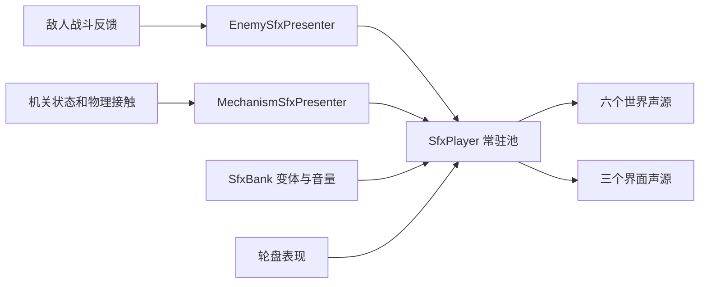

# 敌人与机关音效接入

本轮沿用 `feat/sound`，替换玩家挥剑声，并把敌人和机关接入原有固定音效池。共用 `Assets/_Project/Data/Audio/PlayerWheel_SfxBank.asset`，旧 Cue 序号保持不变，新项追加到末尾。

## 播放内容

| 对象 | 真实触发点 | 声音 |
| --- | --- | --- |
| 玩家轻击 / 重击 | 原 `OnAttackStruck` | 四份短破风变体；轻击约 0.13–0.15 秒，重击约 0.15–0.20 秒，重击音高更低 |
| 敌人近战 / 范围攻击 | `Strike` / `AreaStrike` | 破风；持续攻击窗沿用 Actor 的脉冲去重 |
| 敌人弹体 / 光束 | `ProjectileSpawn` / `BeamSpawn` | 发射 / 蓄能；光束在创建预警时响一次，不逐帧播放 |
| 敌人受击 | `Hit` 且实际 Damage > 0 | 积木、金属、毛绒三组材质声；无敌帧和治疗不播 |
| 敌人死亡 / 散架 | 致命 `Hit` 或 `OnDefeated` | 三组独立材质声；同次死亡去重，不叠普通受击声 |
| 摇杆、按钮 | `CitySwitch.OnChanged`、`ImpactButton.OnPressed/OnReleased` | 开 / 关，保持接触不连响 |
| 生锈齿轮 | 激活 / 关闭 | 开 / 关 |
| 巨石断剑 | Armed / Shattered / Unsealed | 震裂撞击 / 石头碎裂 / 解封 |
| 石头、弹珠、铁箱等 | `OnCollisionEnter2D` 法向接触速度 ≥ 1.5 | 石 / 金属 / 木撞击，静止接触和沿墙滑行不持续响 |
| 回弹块 | 非零击退冲量 | 金属撞击 |
| 可破坏门、栈桥 | 实际破门 / Toppled | 木碎裂；栈桥封印为关闭声 |
| 引信炸弹、轨道炸弹 | 实际消耗、禁用形状后 `OnDetonated` | 爆裂；重复点火不重复响 |

材质分组：积木 Boss/召唤物、石守卫、积木兵、爆炸积木使用木质组；时钟 Boss、发条鼠、时钟炸弹、弹簧怪使用金属组；其余使用软材质组。关卡小怪倒地后可重组，恢复生命后下一次倒地仍可响。对象单纯停用、场景卸载、快照写回均不冒充死亡。

## 接线与调音

15 种敌人预制体已添加 `EnemySfxPresenter`，支持的机关预制体添加 `MechanismSfxPresenter`。`LevelRuntime` 与敌人试验用 `EnemyLabPlayer` 持有唯一 `SfxPlayer` 和 `WorldSfxBinder`；正式 `GameRoot` 嵌套继承。Binder 在已加载场景和后续流式场景中补齐内嵌对象，包含未激活对象；运行时召唤物从已接线预制体继承。

世界物体通过 `PlayAt` 按当前 AudioListener 的 XY 位置衰减：3 米内原音量，默认 24 米外不播放，中间平方衰减，并有轻微左右声像。按发声物体分别限频；同帧不同敌人不互相吞掉。两件有音效组件的物体碰撞时，按 EntityId 选一侧发声。池占满时死亡和碎裂优先于普通攻击、碰撞；界面保有独立三槽。物体被销毁或停用后，已经开始的短音效由常驻池播完。

SfxBank 可调 Clips、Volume、Pitch、MinInterval、MaxVoices 和 Priority（越小越优先）；本轮新增条目默认最短间隔 0.12 秒、最多四个同类声。`SfxPlayer.Volume` 默认 0.85，Hearing Distance 默认 24；单个机关的 Minimum Impact Speed 默认 1.5。暂停拒绝新增世界声并冻结已有声音，续播与回溯清理沿用原逻辑。

菜单 `Tools → 规则游戏 → 音频 → ⑥ 接入敌人与机关音效（保留已有配置）` 可重建接线：保留已有素材与调音，仅补缺失的事件和组件。日常调整请使用菜单⑧，见 [音频试听与配置](音频试听与配置.md)。新场景放一份 LevelRuntime 即可；运行时临时创建机关若不来自预制体，可在组装后调用 `WorldSfxBinder.Install(scene)`。

## 开放素材与复现

- artisticdude 的 [Swishes Sound Pack](https://opengameart.org/content/swishes-sound-pack)，CC0；替代原 knifeSlice。四份原 WAV 保存在 `Doc/AudioSources/SwishesOriginals`，派生播放文件只做高低通、单声道 PCM16/44.1kHz、0.45 增益及 3ms 起音淡入，不拉伸时长。处理命令为 `python3 Tools/Audio/prepare_swords.py /path/to/swishes.zip`，需要 ffmpeg；对应哈希在 `SwishesManifest.json`。
- rubberduck 的 [80 CC0 RPG SFX](https://opengameart.org/node/86018)，CC0；选取七份石、木、锁和法术原 OGG，位于 `Audio/SFX/Rpg80`。
- Kenney [Impact Sounds](https://kenney.nl/assets/impact-sounds) 补充四份重型金属/软材质撞击，CC0，保留原包 License。

`SfxManifest.json` 现记录 35 份原始 OGG（含前两轮），四份派生挥剑 WAV 单独登记。来源链接、作者、许可及逐文件 SHA-256 随仓库保存。短音效统一 PCM、Decompress On Load 和预载；不新增包、混音器或项目设置。

## 验证

菜单 `⑦ 验证敌人与机关音效（PlayMode）` 在原工程临时空场景实例化真实 LevelRuntime、敌人和机关，使用真实 CombatSystem、快照、动态刚体与键鼠输入；结束清理输入设备、退出 Play 并恢复原 Boot。结果位于 `Project-Rule/Logs/WorldSfx/Validation.txt`。玩家与轮盘回归使用原菜单⑤，结果位于 `Logs/PlayerWheelSfx/Validation.txt`。

2026-10-18 原工程 Unity 6000.6.4f1 编译成功，世界音效 83 项通过，玩家与轮盘回归 75 项通过。覆盖 31 项素材、15 种敌人接线、真实近战/弹体/光束、三种材质扣血与倒地、快照复活后再击杀、机关切换/恢复、真实动态石头接触/静止、巨石碎裂、两种炸弹、真实输入破门、距离衰减、限频、暂停和固定声源数。测试初版按累计开关次数断言会计入此前场景操作，现按当前操作增量检查并隔开敌人接触。Console 仍有原 GravityBoulder.ApplyAnchor 给 Static 刚体写速度的警告；未修改该既有物理行为。未执行完整 Player 构建、正式关卡全程试玩或目标设备听感验收。

2026-10-18 更正爆炸选材：此前 spell_fire_02 是火焰法术/燃烧质感，已从 Explosion 槽移除。改为 Kenney [Sci-Fi Sounds](https://kenney.nl/assets/sci-fi-sounds) 的 explosionCrunch_000（CC0，原始OGG不加工），长度约0.777秒，音量0.65、音高0.98–1.02。新素材前20ms RMS约0.416、可听起音约0.07ms，最强20ms位于开头，具有立即爆发而非延迟燃烧的包络；不声称完成了人工听感验收。引信点火不触发 Explosion，只有实际消耗后的 OnDetonated 发声。加入点火不提前响与真实声源选材断言。对照试听为 Doc/AudioPreviews/Explosion/Explosion_Audition.wav，已乘事件0.65与主音量0.85，原包许可随SciFi子目录保存，哈希登记在SfxManifest。

本轮敌人与机关PlayMode回归85项通过，包含点火不提前响、实际爆炸AudioSource选用当前Explosion素材、两类炸弹及原有碰撞/碎裂/暂停/快照；日志Logs/WorldSfx/Validation.txt。仅Explosion条目素材/音高变动，其余Cue（含玩家受击/落地）无差异。

2026-10-18 清亮音色调整：当前 Explosion 使用从上述原件处理的 Explosion_Bright.wav，削减280Hz低中频并在3.5kHz以上提升5dB，14kHz带宽保护；保留低频爆发，峰值0.85。事件音量和音高未改，BGM继续0.25。处理源与哈希在ExplosionBrightManifest.json，脚本prepare_bright_explosion.py。
