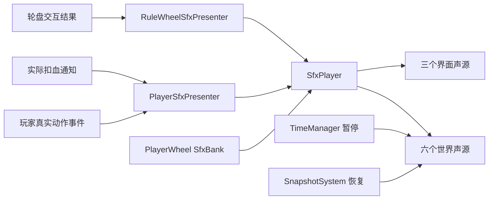

# 玩家与轮盘音效接入

音效已接入 `LevelRuntime.prefab`：根物体持有 `SfxPlayer`，玩家持有 `PlayerSfxPresenter`，轮盘持有 `RuleWheelSfxPresenter`。正式 Boot 的 GameRoot 和 `Test_AreaMusic` 通过嵌套预制体继承接线，使用同一份 `PlayerWheel_SfxBank`。

## 触发时机

| 内容 | 事件或结果 | 素材与表现 |
| --- | --- | --- |
| 地面跳跃 | `PlayerController.OnJumped` | 衣料摆动，两份变体 |
| 二段跳 | `OnAirJumped` | 同类素材，音高略高 |
| 蹬墙跳 | `OnWallJumped` | 两份衣料变体 |
| 落地 | `OnLanded` | 约0.110秒鞋底接触声（PlayerLand，保留高频瞬态），音量0.33；站立不重复播 |
| 冲刺 | `OnDashed` | 较低音高的衣料掠过声 |
| 轻击、重击 | `OnAttackStruck` | 短破风变体（Swishes）；重击独立素材且更低沉；起手阶段不提前播，空挥也有声音 |
| 玩家受击 | `EntityDamageable.OnDamageTaken` | 实际扣血后播放约0.2秒无叫声短击（PlayerHurt，保留清亮高频），音量0.60；致命一击也成立 |
| 打开轮盘 | `SelectionOpened` | 打开声 |
| 属性或关系切换 | `ChoicePreviewed` | 轻选择声；悬停同一项不重复播 |
| 确认成功 | `SelectionClosed(true)` | 确认声；免费取消已生效规则同样属于确认操作 |
| 退出选择 | `SelectionClosed(false)` | 取消声；重复关闭不再通知 |
| 返回一级 | `SelectionReturned` | 轻返回声 |
| 确认被拒绝 | `SelectionRejected` | 错误声；能量不足、冷却或锁定时不冒充成功 |

承伤通知位于目标自身的抗性、无敌和血量结算之后，Amount 为实际扣掉的生命（最大到剩余血量）。治疗、完全免伤、无敌帧、零伤害纯击退不通知；伤害挂账期间不播，净额实际结清扣血时才播。快照恢复直接写回 EntityStatus，不经过该通知，因此恢复较低生命不会误播受击。

## 暂停和资源复用

世界音效响应 `TimeManager.OnPausedChanged`：暂停已有声源、拒绝新的动作声，恢复后从原播放位置继续。界面拥有三个独立声源，保持可用，且设置 `ignoreListenerPause`。轮盘原本使用慢时间，音效仍按真实时间播放，不改变任何游戏倍率。

世界回溯时清除当前世界短音效及其触发间隔，保留界面声音。音乐继续使用原来的四个声源与压低音量策略，两套系统分别处理自己的声源，不修改 `AudioListener.pause`。

同一音效具有最短间隔和最多同时播放数。六个世界槽位满时，较高优先级的声音可替换较低优先级的旧声源，受击优先级高于动作；界面通道不会被世界声音占满。变体与音高使用独立的 `System.Random`，不消耗玩法使用的 Unity 随机数。

## 配置和接线

配置资产：`Assets/_Project/Data/Audio/PlayerWheel_SfxBank.asset`。每项可调整 Clips、Volume、Pitch 范围、Min Interval、Max Voices 和 Priority（数值越小越优先）。根物体 SfxPlayer 的 Volume 控制整体音效音量，默认 0.85。短音效为 Decompress On Load、PCM、预载，播放时无需等待流式解码。

菜单 `Tools → 规则游戏 → 音频 → ④ 接入玩家与轮盘音效` 可重新接线 LevelRuntime，保留已经存在的音效配置。新增自定义场景若没有使用 LevelRuntime，需要放置一份 SfxPlayer，并把玩家与轮盘表现组件的 Audio 指向它；不要为每次动作创建临时声源。

素材来自 Kenney 的 [Impact Sounds](https://kenney.nl/assets/impact-sounds)、[Interface Sounds](https://kenney.nl/assets/interface-sounds) 和 [RPG Audio](https://kenney.nl/assets/rpg-audio)，均为 CC0。原始 License.txt 随各子目录保存；原始 OGG 素材的文件名、包来源和哈希位于 `Doc/AudioSources/SfxManifest.json`。

## 验证入口

菜单 `Tools → 规则游戏 → 音频 → ⑤ 验证玩家与轮盘音效（PlayMode）` 使用真实 LevelRuntime、临时键鼠设备、真实物理和战斗链路验证。测试在临时场景运行，结束后移除临时输入设备并恢复原场景；运行前应保存场景。结果保存到本地 `Project-Rule/Logs/PlayerWheelSfx/Validation.txt`。

2026-10-18 在原工程 Unity 6000.6.4f1 中通过编译和 58 项定向 PlayMode 检查，覆盖真实键鼠动作、实际伤害与挂账、真实轮盘鼠标悬停、确认成功/失败、返回/取消、暂停采样位置与续播、回溯清理、独立随机数和声源生命周期。验证结束后退出 Play 并恢复 Boot 场景。未执行完整 Player 构建或目标设备听感验收。

本轮替换挥剑素材并扩展敌人与机关音效，新的来源、空间衰减和接线见 [敌人与机关音效接入](敌人与机关音效接入.md)。原玩家和轮盘资产路径、事件与池配额保留。

集中试听和中文参数编辑入口为菜单⑧，见 [音频试听与配置](音频试听与配置.md)。
