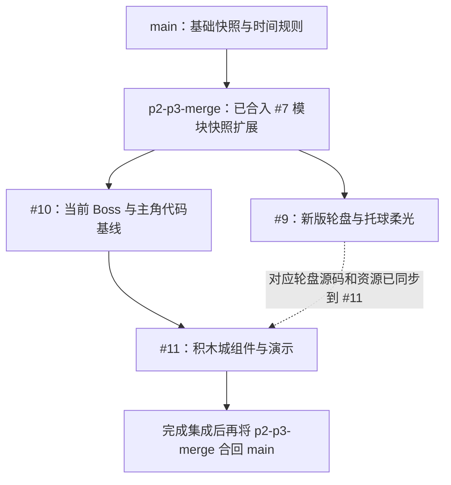
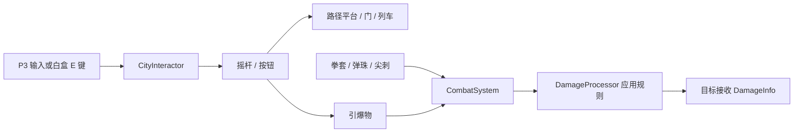

# 积木城地图组件

需求来源：策划《游戏组件需求大全(1).xlsx》的“地图功能组件类”与“地图瓦片类”。表内标为“全局”的组件作为积木城可用组件交付，不代表正式地图必须全部使用；魔王城专属溜溜球不在本批范围。

## 分支依赖与合并顺序

[PR #11](https://github.com/zhou914485/Project-Rule/pull/11)（`feat/brick-city-components`）的合并目标是 **`p2-p3-merge`**。以下状态于 2026-10-16 核对，后续以实际合并记录为准。

### 快照系统的来源

- `main` 已有队友提交的基础 `SnapshotSystem`、`ISnapshotSystem`、`Snapshot` / `EntityState` 和 `TimeRule`。基础设施来源包括提交 `527ec23`，时间规则落地包括 `5e70df6`。轮盘不是另一套快照系统的提供者。
- [PR #7](https://github.com/zhou914485/Project-Rule/pull/7)（提交 `64d6502`）扩展了这套系统，增加 `ISnapshotParticipant`，并在 `EntityState` / `SnapshotSystem` 中接入模块状态采集与恢复，用于敌人的 AI 阶段、计时和其他自定义状态。这部分已合入 `p2-p3-merge`，当前 `main` 尚未包含该扩展。
- 本批 `CityMechanism` 实现上述扩展接口，机关的路径进度、引信、破裂状态、冷却等通过它进入现有世界快照。组件、轮盘均不额外初始化第二个 `SnapshotSystem`。

### 各 PR 的关系

1. 保留 `p2-p3-merge` 已有的 #7 快照扩展，供机关与敌人共用。
2. 建议先将 [#9](https://github.com/zhou914485/Project-Rule/pull/9)、[#10](https://github.com/zhou914485/Project-Rule/pull/10) 合入 `p2-p3-merge`，二者无需按编号先后合并。#10 是本分支分叉点 `2343be2` 所属的历史/主角代码基线，不是快照扩展接口的来源；先合 #10 可避免在 #11 中重复审查 Boss 改动。
3. 再合 #11。#11 的 `f554ce7` 已同步 #9 对应版本的轮盘运行时代码与资源，所以 #9 未先合入时，这部分依赖仍随 #11 提供；不能仅挑选积木城提交 `8fb19b8` 而遗漏轮盘依赖。#9 先合入后，注意保留其接入原场景的改动，#11 未修改原场景或 `LevelRuntime`。
4. 需要交付 `main` 时，将完成上述集成的 `p2-p3-merge` 合回 `main`。**不要把 #11 直接改为以当前 `main` 为目标，或只复制组件目录过去。**当前 `main` 缺少模块快照接口与桥接实现，且没有本次使用的完整集成基线。

### 手动摘取代码时必须一起保留

若必须手动摘取，先协调好基线，至少把下面四个文件视为同一套快照扩展，不能只补一个空接口让编译通过：

- `Assets/_Project/Scripts/Infrastructure/Shared/Snapshot/ISnapshotParticipant.cs`。
- `Assets/_Project/Scripts/Infrastructure/Shared/Snapshot/ISnapshotParticipant.cs.meta`。
- `Assets/_Project/Scripts/Infrastructure/Shared/Snapshot/EntityState.cs` 的模块状态字段。
- `Assets/_Project/Scripts/Infrastructure/Snapshot/SnapshotSystem.cs` 的模块采集、恢复与缺失对象处理。

以上共四个文件（含接口 `.meta`），来自 #7，已包含在目标集成分支；正常合并无需重复移植。还需保留 `f554ce7` 的轮盘依赖和 `8fb19b8` 中 `MotionMover` / `PlayerController` 的平台承载改动，不能只复制机关脚本和 Prefab。

### 正式场景接线前提

- 由现有 `RuleSystemDriver` 初始化规则、`WorldRegistry`、`TimeManager` 与 `SnapshotSystem`；UI 和机关共用这套实例。
- 要参与回溯的对象必须通过 `RuleAffectedBody` 进入世界注册表。只有快照系统源码、但对象没有登记，仍不会采集该对象。
- 需要恢复自定义状态的根刚体只保留一个 `ISnapshotParticipant` 实现。`CityMechanism` 已负责机关状态；若添加新模块，应合并到它的状态中，避免多个实现只采集到第一个。
- 合并冲突时保留原系统的规则槽位恢复、`RestoreMode.KeepEnergy`、`OnRestored` 及模块状态桥接，不能以新建独立快照服务代替。正式新场景需单独确认这些接线，白盒表现不代表所有地图物体已自动接入。

当前时间反转仍是历史快照点恢复，时间恒定通过现有 `ITimeRewindControl` 返回定点；本批没有实现逐帧倒放，也没有把内存快照当作磁盘存档。

## 直接试用

- 打开 `Assets/_Project/Scenes/Test_BrickCityComponents.unity`，进入 Play。
- 场景使用现有 `LevelRuntime` 的主角与镜头，接入 `feat/rule-wheel-orb` 已提交的新版同心双层轮盘、朝向适配与托球柔光；选择期间为 0.001 倍速。移除旧 `P4Hud`，使用独立的中文演示提示。从左向右是八个试验区；`F1` / `F2` 切换下一个 / 上一个试验区，弹珠封闭试验房也通过该入口进出。
- `E`：操作附近机关。**交互键由 `CityInteractor` 自己读**（键盘 E / 手柄 Y，门禁走 `IsGameplayInputSuppressed`），
  所以正式关卡只要把这组件挂在主角身上就能用；白盒场景生成时把它的 `_readInteractKey` 关掉，
  按键仍留在 `BrickCityLabControls` 内 —— 两处同时读 E 会让「按一下切换一下」的摇杆变成按一下等于没按。
- `F5`：整场恢复初始状态，并清空本轮演示奖励。
- `F6` / `F7`：标记 / 恢复世界快照，用于观察机关中途状态回溯。
- `F8`：回到最近一次攻击激活的秋千检查点；未激活时无操作。
- `F9`：调试扣除 30 能量，便于测试石像回蓝。
- 地形复用 `Level_Start_01` 已有石头地板和平台纹理，按原图比例平铺；本地 `Level_01` 仍是早期白盒，因此本演示独立搭建同材质机关路线。两张原地图均不修改。机关形状与颜色用于辨认，不作为最终组件美术。角色继续使用项目当前版本。
- 状态与说明固定在屏幕边缘，字号为 24–40（1280×720 设计分辨率）；区域与交互说明全部为中文，并随所在区域切换，不再使用可能移出镜头的世界标牌。打开轮盘时收起机关说明与底部快捷键，避免遮住选项。旧 P3 调试面板只在本场景实例中禁用。

## 可拖用资产

全部位于 `Assets/_Project/Prefabs/BrickCity/`。

| Prefab | 用途 | 主要配置 |
|---|---|---|
| CityLift | 小飞机升降平台 | EndOffset、Speed、StationWait |
| CityGate | 升降门 | CityPathMotor；不承载角色，关闭时遇到角色停止 |
| CityLever | 摇杆 | FollowMotor 可直接拖入电梯/门，多处摇杆读取同一目标状态；`Toggle = 1` 按一下切一次，把手在 `_offAngle` 25° / `_onAngle` −35° 之间扳动。**攻击盒或纸飞机打中它也会翻一次**（`ImpactByContact`，与按 E 同一条翻转逻辑） |
| CityButton | 单次按钮 | OnChanged 连接门、拳套或炸弹的 SetOn(bool) |
| CityHammer | 弹簧拳套 | Stroke 可设上下/左右方向，等待、预警、出拳、停留、收回分别调节 |
| CityMarble | 受攻击可弹开的弹珠 | InitialVelocity、刚体质量/重力、CityDamageZone 伤害与间隔 |
| CityBubble | 起跳后破裂的平台 | RespawnSeconds 为 0 时只通过重置/回溯复原 |
| CityRefill | 一次性回蓝石像 | `_amount`（回多少能量，Inspector 可配）、`_shards`（塌落碎片数）；**按 E 或攻击盒 / 纸飞机打中都算触发**（`IContactSwitch.ImpactByContact`，与按钮 / 攻击宝箱同一条路）；用掉即塌落、关碰撞关显示，能量已满时不消耗；回溯后复原可再用 |
| PlayerSpawnPoint | 落点（出生点 + 存档点已合并） | `_id`、`_activateByAttack`；攻击盒 / 纸飞机打中才记录复活点并存档，走近不再自动记录；已经存过的点再打只重播表现 |
| CityChest | 宝箱 | SourceId、Kind、Amount、OpenByAttack、Ability、Attribute、Relation、Receiver；`Kind = 生命 / 能量` 时 `Amount` = **上限提升多少** |
| CityReward | 两色龙珠（生命 / 能量） | 同宝箱；PickupVisual 在领取后隐藏 |
| CityTrain | 两站往返小火车 | 同路径平台；AutoReturn、StationWait；OnArrived 留给车站/场景流程 |
| CityBomb | 按钮引爆物 | Fuse、Radius、Damage、Knockback；圆形爆炸区域按实体去重 |
| CityThorns | 接触伤害占位块 | 独立形状危险区；正式瓦片尖刺仍复用 HazardField |

美术只需替换各 Prefab 的 `Visual` 子物体。根物体保存真实物理尺寸，避免用根缩放来适配图片。弹珠需要保持圆形碰撞体；平台、门、泡泡的碰撞尺寸应按正式图片再校准。

## 联动与伤害

`CityDamageZone` 使用显式重叠查询并按目标去重，不依赖主角是否收到触发回调。连续接触有逐目标冷却。拳套只有出拳与停留阶段伤人，黄色为预警、红色为有效伤害；停止运行会冻结当前阶段，继续运行从原阶段推进。

所有攻击仍由 `CombatSystem` 组装 `AttackInfo`，交 `DamageProcessor` 处理伤害与因果，再发送 `DamageInfo`。弹珠实现 `IDamageable`，不伪造生命条，读取处理后的击退并施加真实物理冲量；不是直接改主角血量。

## 平台与角色协作

平台在物理更新顺序 -40 提交承载位移，主角保留自己的移动速度，`MotionMover` 在唯一一次 Slide 中合并平台位移。下降时仅在这次 Slide 临时忽略支撑平台碰撞，其它墙、地面和天花板继续阻挡；起跳时不带走后续平台位移。

平台会预先检查自身与乘员的移动空间，受阻时停止推进路径进度。两端摇杆通过 FollowMotor 同步，不会因另一个摇杆操作过而需要多按一次。

## 规则与回溯

所有机关根物体通过 `RuleAffectedBody` 登记进世界注册表。每个根刚体只放一个 `CityMechanism` 或其派生组件，避免快照系统只采集到第一个模块。

- 动态弹珠：由刚体应用重力、质量、摩擦，受到时间规则和物理碰撞影响。
- 电梯、门、列车和拳套是有动力/导轨的机关：按路径推进，时间倍率影响推进速度；不会因为重力反转擅自脱轨。是否需要某个特殊规则改变机关方向，由关卡配置另行扩展。
- 路径进度、目标站、停站余时、拳套阶段/计时、开关状态、泡泡破裂/重生余时、回蓝石像是否已用掉、炸弹引信、接触伤害冷却均随快照恢复。
- 破裂或消耗时保留 GameObject，关闭碰撞/显示，不 Destroy，回溯才能恢复。

## 需要主程接入的正式接口

### 存档 / 落点

**出生点与存档点已合并（2026-10-18）**，白盒里那个绿色方块现在是 `PlayerSpawnPoint`（`brick-city-lab-rest`），
不再有 `CityCheckpoint` 组件：

- 2026-10-20 起**不再走近自动记录**：攻击盒 / 纸飞机打中它才存档（`IContactSwitch.ImpactByContact`，
  与按钮 / 宝箱同一条路）；已经存过的点再打只重播表现，不改当前复活点、不重复写盘；
- 秋千过场会**一直循环坐姿荡秋千**，直到玩家再次按下玩法输入才下来；ESC / 手柄 Start 不算「继续」；
- 白盒里按 **F8** = 回到最近记录的落点（死亡自动复活走的是同一条 `Respawn()`）；
- 组件广播 `SaveRequested(string id)`，磁盘保存由 `PersistenceDriver` 订阅 `CheckpointBus` 完成。

⚠️ 落点**不再进世界快照**。旧检查点靠「全量内存快照」记位置，玩家走出加载半径、分区卸载后
实体被销毁，复活只恢复半个世界；现在玩家只记一个编号 + 位置，跟分区加载彻底脱钩。

### 奖励与升级

`ICityRewardReceiver` 定义 `IsClaimed(sourceId)` 和 `TryGrant(sourceId, CityReward)`。每个宝箱/龙珠场景实例必须配置唯一 SourceId；能力 / 规则奖励可以把 Receiver 留空，自动找玩家身上的 `PlayerProgress`。

没有适配器、ID 为空或适配器拒绝发奖时，机关不消耗。适配器必须原子完成奖励与已领取登记；时间回溯后结合永久领取记录恢复显示，不会通过反复开箱刷奖励。具体奖励是否为永久进度需主程与策划确认；当前适配接口按永久领取设计。

组件需求表“地图功能组件类”第 13 行将龙珠定义为全局宝箱奖励，对应血量和蓝条升级；没有规定积木城必须摆放几颗。
演示场景摆放两色拾取物用于检查奖励接口，正式关卡按策划布置。
**战斗力那条奖励已删除**（2026-10-20，没有真正的结算）—— 枚举 0 号退役、其余编号不动，
场景 / 预制体里的 `Kind` 整数因此不用迁移。

生命 / 能量宝箱在正式链路里是**真的抬上限**：`PlayerProgress` → `EntityStatus.RaiseMaxHealth/RaiseMaxEnergy`，
增量与领取记录都进存档（`IPlayerProgressStore`）。白盒的 `BrickCityLabControls` 仍然只维护演示计数
（那两个拾取物的 `Receiver` 显式指向它），用于检查「奖励只发一次、回溯不重复领」，不是正式经济系统。
正式接入后移除此演示适配器与调试按键。

### 跨地图列车

CityTrain 已提供两站运动与承载。OnArrived(bool atEnd) 可接进出站表现和关卡流程。正式目的地图、转场、加载与存档由场景系统处理，本批不在组件内硬编码地图名字。

## 重新生成

菜单 `Tools/规则游戏/积木城/生成组件与白盒` 会覆盖本批 14 个 Prefab 和独立测试场景。正式关卡应使用场景实例覆盖或自己的 Prefab Variant，不要把正式关卡编辑写进该白盒后再重建。

本工具不会更改 LevelRuntime、P4Hud、正式地图或 Build Settings。新版轮盘仅按文件引入其已提交的运行时代码、布局、光球数据和材质，不覆盖轮盘分支上的主角参数或测试场景。正式机关美术、动画、音效和图文说明交付后，再替换 Visual 与事件表现。

本轮用 Unity 6000.6.4f1 生成实际资产，并在新白盒中完成 8 项定向 Play 检查：双端摇杆、电梯升降承载、关门受阻、泡泡起跳与回溯、弹珠击退、接触伤害与一次性回蓝（回蓝量 + 碎掉消失）、拳套/引信回溯、检查点与奖励防重复。首轮 7 项通过；拳套用例原先依赖固定步数，改为等待实际攻击窗口后只补跑该项并通过。记录保存在本地 Library/BossFixReview/CityChecks.txt 与 CityChecks-retry.txt。

未重跑整套敌人/主角检查，也未构建 Player。字体图集原有本地改动已原样保留。最终美术、按键手感、正式关卡组合和存档后端需要后续手动/联调验收。

本次演示表现更新已在编辑器实际导入、重建场景并进入 Play：确认新版轮盘开关、托球柔光和大字中文提示正常；常态与轮盘两张画面均已查看，未见文字裁切。石头图按原素材左上角锚点与碰撞体对齐。仅因首次画面暴露旧调试浮层与地形锚点问题、后续用户要求放大字体而定向复查，未重跑机关行为套件。一次性编辑器任务已移除。
