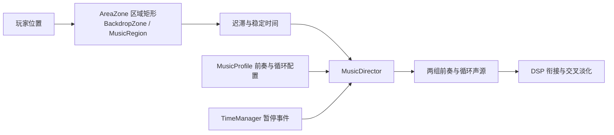

# 背景音乐接入

三套区域音乐由 `RuleGame.Presentation.Audio` 驱动。`LevelRuntime.prefab` 已挂载 `MusicDirector`，Boot 中的常驻 GameRoot 通过嵌套预制体继承该组件；序章和中心区暂用积木音乐。音乐归属通过区域矩形配置，不根据场景名或预加载事件推断。

**2026-10-21 起区域矩形与背景合并**：`BackdropZone` 新增 `Music` 字段，同一块区域只摆一次，背景和音乐读同一个物体、同一个矩形、同一个 Priority。`MusicRegion` 保留给「只有音乐、没有背景」的小区域。

## 播放行为

- 积木、发条：本次运行首次进入播放前奏，再进入循环。返回已经访问过的区域直接播放循环。
- 毛绒：整曲循环。
- 跨区域：默认 1.5 秒平滑交叉淡化。新曲先准备好音频并预留 0.5 秒 DSP 排程时间，旧曲在这期间继续播放。
- 边界：保留当前区域至超出边界 1 米，新归属稳定 0.25 秒后才请求切换。重叠区域优先使用更高的 Priority，同 Priority 取面积小的。
- 连续跨越多个区域时，新请求保留为最终目标；已经参加淡化的曲目可反向淡化，第三首等待当前淡化结束，避免截断仍可听见的音乐。
- 暂停：订阅 `ITimeManager.OnPausedChanged`，用非缩放时间平滑压低到正常音量的 35%，音乐继续。恢复暂停后回到原音量。
- 时间规则不改变音乐速度和音高。音乐不进入世界快照，回溯后根据玩家位置重新判断区域。
- 不改变 `AudioListener.pause`、`Time.timeScale` 或任何伤害、规则与存档逻辑。



## 地图接入（区域矩形已合并）

1. 保留 Boot / GameRoot 已有的常驻 `LevelRuntime`，不要在每个流式分区里额外放一套播放器或 AudioListener。
2. **正式关卡优先用场景里已有的 `BackdropZone`**：`Profile` 填背景，`Music` 填区域音乐。只想要音乐、不换背景时把 `Profile` 留空即可（`BackdropDirector` 会跳过没有贴图的区域）。
3. 没有 `BackdropZone` 的小区域（试听场景、临时 BOSS 房）才用 `MusicRegion`：从 `Assets/_Project/Prefabs/Audio/` 拖入。它与 `BackdropZone` 进同一张登记表，音乐侧不区分类型。
4. 把区域物体移到对应地图中心。区域可以是**多个矩形的并集**（异形房间 / L 形走廊 / 竖井）：Inspector 里「把单矩形拆成多段」后加矩形、吸附到 0.5 格，Scene 视图每段都有独立手柄（`AreaZoneEditor` 对两种区域都生效）；不需要碰撞体。位置、旋转和缩放均由物体 Transform 决定。背景 / 音乐仍是**整块区域一份**，多段只影响「从哪儿算进入」。
5. 重叠时 Priority 高的优先；同 Priority 取**面积小的**（更具体的区域），不依赖注册顺序。上一个区域在边界外 1 米内继续保留，避免来回换曲。
6. 同一个主题的多个区域复用同一份 MusicProfile，区内移动不会重新开始音乐。特殊小区域可提高 Priority。
7. 未覆盖的位置使用 `MusicDirector.DefaultProfile` 的序列化配置；当前为积木区。停用或卸载区域后会重新解析归属。

⚠️ 不要拿 `PartitionCatalog` 的矩形当音乐区：分区矩形互相重叠（例如 `springnew` 的 277×90 把 Start / Center 整个包住），直接照抄会让新手村也放发条曲。按关卡几何摆，或复用已经调好的 `BackdropZone`。

`BackdropSetupTool` 的菜单 ② 会删掉旧的单段区域再重建，并**保留已经手拆成多段的异形区域**；它按区域名继承旧的 `Music`，重跑不会把手工填的音乐清掉。以后扩成 11 区域表驱动时，`AreaPlan` 也要带上 `Music` 字段，并在 `CreateZone` 里写进去。

配置位于 `Assets/_Project/Data/Audio/`，每份可以调整 Volume 和 Crossfade Seconds。三地区游戏音量现统一为 0.25（原0.65，约降低8.3dB），新建MusicProfile默认也为0.25；暂停继续按这个较低基准压至35%。播放器的 Boundary Hysteresis、Region Delay、Paused Volume、Duck Seconds 和 Schedule Ahead 均可在 LevelRuntime 的 Inspector 中调整。

## 素材与导入

这次交付的 15 份 OGG 全部保存在 `Doc/AudioSources/MusicOriginals/`（按区域分目录），SHA-256、采样长度和裁尾结果见 `Doc/AudioSources/MusicManifest.json`。播放用 WAV 15 份位于 `Assets/_Project/Audio/Music/`，双声道、44.1 kHz；10 份 `MusicProfile` 位于 `Assets/_Project/Data/Audio/`。

| 用途 | MusicProfile | 前奏 | 循环/整曲 |
| --- | --- | ---: | ---: |
| 积木区 | `Bricks_MusicProfile` | 11.141 秒 | 87.947 秒 |
| 积木 Boss | `BossBricks_MusicProfile` | 2.243 秒 | 61.649 秒 |
| 发条区 | `Clockwork_MusicProfile` | 2.776 秒 | 61.991 秒 |
| 发条 Boss | `BossClockwork_MusicProfile` | 4.124 秒 | 53.493 秒 |
| 毛绒区 | `Fluffy_MusicProfile` | — | 79.339 秒 |
| 毛绒 Boss | `BossFluffy_MusicProfile` | — | 58.874 秒 |
| 魔王城 | `Dungeon_MusicProfile` | — | 84.380 秒 |
| 魔王城 Boss | `BossDungeon_MusicProfile` | 2.475 秒 | 71.866 秒 |
| 新手村 | `Village_MusicProfile` | — | 132.299 秒 |
| 主题/主菜单 | `Theme_Musicbox_MusicProfile` | — | 79.435 秒 |

积木 Boss 房已经接上 `BossBricks_MusicProfile`；其余 Boss / 魔王城 / 新手村 / 主题的 Profile 已建好，但没有对应区域，等关卡摆 Zone 时填进去。毛绒区这次用新交付版本替换了 10-19 的旧文件（GUID 不变，见 manifest 的 hash）。

源文件含较长的导出尾部近静音。处理脚本只去掉低于 -60 dBFS 的连续尾部，并在最后可听样本后保留 20 ms；音乐节拍、混响尾音与首尾乐句按交付素材保留，不重新编曲或自动推断循环点。

重新处理新的交付文件：

```sh
python3 Tools/Audio/prepare_music.py '/绝对路径/背景音乐(1)'
```

脚本遍历 `积木区 / 发条区 / 毛绒区 / 魔王城 / 新手村` 五个目录和根目录的 `bgm_theme_musicbox.ogg`，需要本机 ffmpeg（不在 PATH 时设 `FFMPEG=C:\ffmpeg\ffmpeg.exe`）。长曲 Streaming、前奏 Decompress On Load、预载开启；Vorbis 质量 1、保持 44.1 kHz 双声道。Unity 菜单 `① 接入三地区域音乐` 仍只负责原来的三个地区配置、区域预制体和 LevelRuntime 接线；新增的 Boss / 魔王城 / 新手村 Profile 不会被动到。

## 试听与验证

打开 `Assets/_Project/Scenes/Test_AreaMusic.unity`，直接 Play。玩家从积木区开始，向右依次进入发条区和毛绒区；每区宽 20 米，主题交界在 x=-10 和 x=10（从积木区中心 x=-20 出发）。打开规则轮盘可检查暂停音量。

菜单 `Tools → 规则游戏 → 音频 → ③ 验证背景音乐（PlayMode）` 会记录当前已保存场景，进入临时空场景执行检查，退出 Play 后自动恢复原场景。请先保存自己的场景修改。验证包含一条「BackdropZone 上的 Music 能驱动切曲」的断言，覆盖合并后的路径。

菜单 `Tools → 规则游戏 → 音频 → ④ 检查区域音乐覆盖（EditMode）` 逐个 additive 打开分区表里的关卡场景，数一遍带音乐的 `AreaZone`：没有就 WARN，有区域但曲子不可播放就 FAIL。它只读、不保存，结果写到 `Logs/AreaMusic/Coverage.txt` —— 正式场景漏摆区域时，PlayMode 验证是发现不了的。

2026-10-18 在 Unity 6000.6.4f1 的原工程 Editor 中，37 项定向检查通过：真实播放采样推进、两组前奏接循环、积木与毛绒循环回绕、两路非零音量交叉淡化、暂停与慢时间、预加载不换曲、边界迟滞、回访不重播前奏、快速切区、区域停用及播放器重新启用。结果保存在本地 `Project-Rule/Logs/AreaMusic/Validation.txt`。源文件哈希和派生 PCM 采样长度也已核对。验证未执行完整 Player 构建或目标设备听感验收。

## 开放音效候选

最初准备的 Kenney CC0 音效现已扩展并接入玩法，见 `Assets/_Project/Audio/SFX/Kenney/`。木地板和地毯脚步可分别用于积木、毛绒，木质/金属/铃铛/软材质碰撞可用于机关与敌人，界面包包含打开、关闭、选择、确认和错误声。原始 License.txt 随素材保留，文件列表与哈希见 `Doc/AudioSources/SfxManifest.json`。

来源：[Impact Sounds](https://kenney.nl/assets/impact-sounds)、[Interface Sounds](https://kenney.nl/assets/interface-sounds)、[RPG Audio](https://kenney.nl/assets/rpg-audio)。官方页面和下载包标注 CC0。玩家跳跃、落地、冲刺、挥剑、实际受击及轮盘交互已接入，详见 [玩家与轮盘音效接入](玩家与轮盘音效接入.md)。用户提供的背景音乐与这批 CC0 音效分别记录来源。

敌人攻击/受击/死亡和机关开关/碰撞/碎裂已继续接入；挥剑现使用独立 Swishes 素材，来源与验证见 [敌人与机关音效接入](敌人与机关音效接入.md)。

菜单⑧提供三地区域音乐配置、前奏/循环/接点原声预览及试听场景快捷入口，见 [音频试听与配置](音频试听与配置.md)。重跑菜单①保留已有配置的音乐素材选择。

2026-10-18 用户明确反馈游戏运行时BGM过大。三份MusicProfile的Volume由0.65降至0.25，约-8.3dB；播放器、音效总音量、前奏/循环、淡化、暂停倍率均保持原逻辑。新建MusicProfile默认值同步降低。原工程定向PlayMode音乐回归40项通过，新增断言确认三个实际循环声源音量均为0.25；日志Logs/AreaMusic/Validation.txt，恢复Test_AreaMusic。原声试听仍播放原始素材，游戏音量在配置中单独控制。
