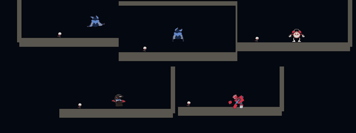

# 规则释放 · 神圣光潮

规则成功生效时，从主角手部光球（旧白盒没有托球动作时取手侧位置）或实际敌方施法者向外推出厚重光潮。主角纯白；敌方直接读取原 EnemyVfxProfile 的 Accent / Secondary：蝙蝠紫、闹钟金黄、兔子粉、砖块 Boss 橙。没有特效配置的对象使用白色回退。渲染时混入柔白淡化敌方配色，保留颜色身份；中心使用圆形柔光，不含十字光柱。

光潮以真实时间展开约 0.70 秒。扩散终点按施法点到实际世界相机最远角点的距离动态扩大，主环至少越过该距离的 3.2 倍加 2 米，并跟随轮盘特写拉回、超宽屏和偏心取景继续增大；所有延迟光圈离屏后停止渲染。规则取消、覆盖、到期时从画外重新回吸，约 0.55 秒收进能量核。正式暂停冻结，时间失效与轮盘慢时间不阻塞视觉。

## 自动接入

无需修改场景或预制体。RuleWheelPresenter 在有效会话创建后发出 Ready，Presentation 层立即附加并绑定 RuleCastVfx，因此缺少 RuleSelectionOrbView 的 Boss 白盒也能显示主角特效，首次同帧释放不会漏接。现有 EnemySpriteAnimator、FieldMinionView、ChargingCubeView 为敌人附加并去重；EnemyActor 的成功施法通知附带实际属性/关系，只在正确的施法者播放。

每位施法者最多保留 12 个复用槽。停用、死亡清理；时间反转等瞬时规则在完整展开后自行收束，失败请求不播放。快照恢复不重播释放冲击；只静默恢复可确定归属的玩家画外状态。现有快照没有敌方施法者身份，因此不猜测敌方归属、不补播旧敌方光潮。

运行时入口在 `Scripts/Presentation/RuleWheel/RuleCastVfx.cs`；光感在 `Shaders/RuleStarHalo.shader`；Resources/RuleCastVfx/StarHalo.mat 保留构建所需 Shader 引用。Screen 混合与柔性压高光保留场景轮廓，没有改摄像机/全局 Volume/URP 设置、费用、伤害或敌人 AI。

## GIF 预览

五组均为生产 Shader 和真实规则事件的 Unity 实际渲染，使用固定镜头/固定角色姿态便于看清效果；不含说明文字、标题、字幕或进度条，只对实际截图进行缩放、帧采样和 GIF 调色板压缩；每个 GIF 均小于 1,000,000 字节。每段展示释放前、向外扩散、完全出屏、主动取消后的画外回吸、完全清理。

单独预览：[主角白色](特效预览/RuleSacredWave/RuleSacredWave_Player.gif)、[蝙蝠紫色](特效预览/RuleSacredWave/RuleSacredWave_Bat.gif)、[闹钟金黄](特效预览/RuleSacredWave/RuleSacredWave_Clock.gif)、[兔子粉色](特效预览/RuleSacredWave/RuleSacredWave_Rabbit.gif)、[砖块橙色](特效预览/RuleSacredWave/RuleSacredWave_Brick.gif)。

复现：在完整可丢弃工程副本运行 `RuleGame.Editor.RuleWheel.RuleCastVfxPreview.RunBatch`，然后在仓库根执行 `python3 Tools/RuleVfx/create_preview.py <工程副本>/Logs/RuleVfxPreview`。Python 需要 Pillow。帧记录保留真实时间戳和阶段状态，GIF 导出不改变特效时钟。

## 验证

独立 PR 直接基于上游 main，不包含小怪 PR #20 的改动。原 feat/enemy 工作区的 117 项验证已通过；在 main 的 16 类已有敌人上重新验证生命周期/配色/URP 像素 **67 项通过**，四 Boss 原样场景的实际 Shift 释放、18 米半高/2.4 超宽视野/12 米偏心、完全出屏和画外回吸 **44 项通过**，合计 **111 项、0 失败**。结果见 `特效预览/RuleSacredWave/Lifecycle-main.txt` 与 `Scenes-main.txt`；运行日志为 `/tmp/rule-vfx-soft-lifecycle.log` 与 `/tmp/rule-vfx-soft-scenes.log`。场景验证优先使用已有集中小怪测试场；main 尚未提供时改用兔子/砖块白盒，不生成或修改场景。

本轮未执行完整 Player 打包、正式关卡人工手感或多规则同时触发的 GPU 压力验收。
